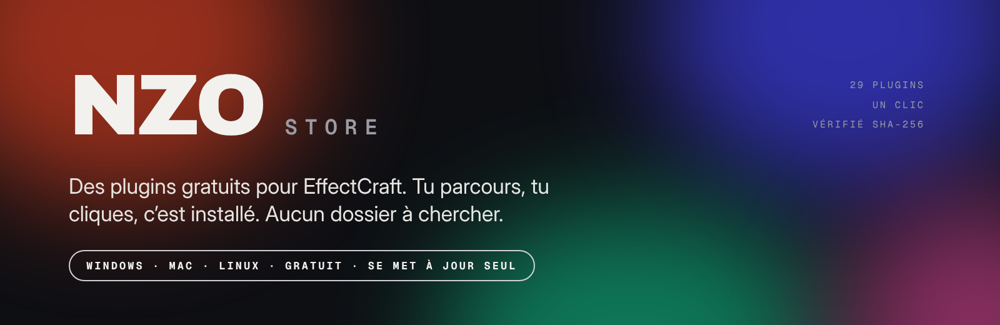
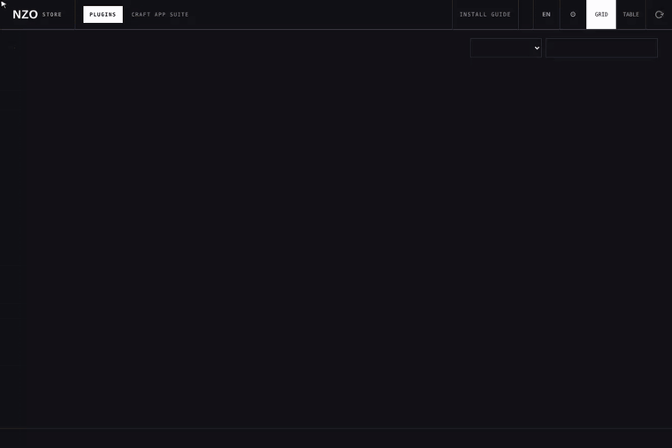
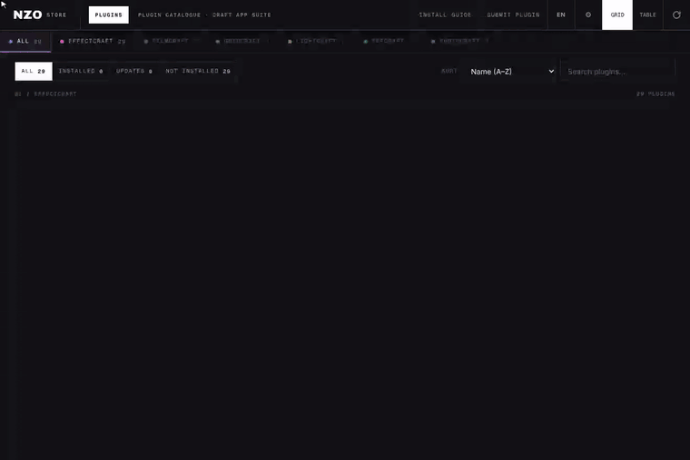
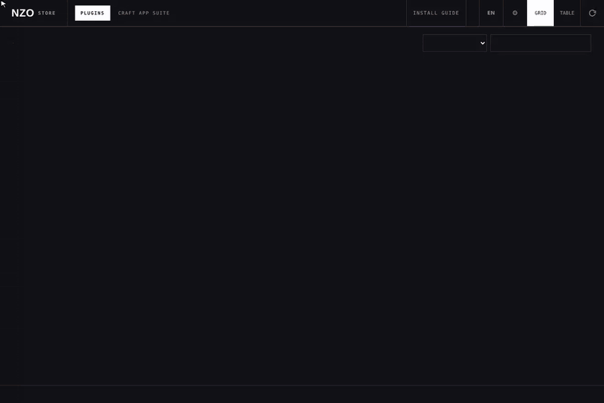
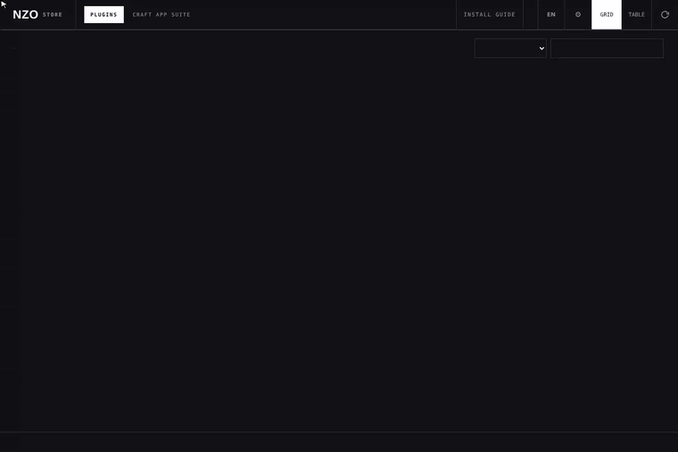
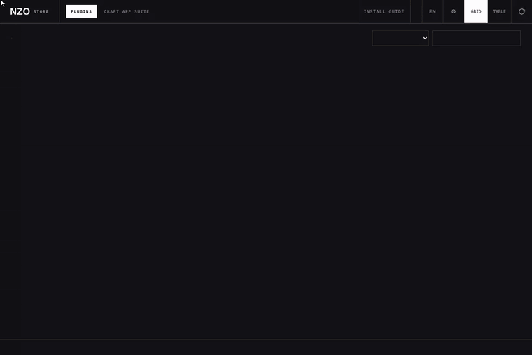

<p align="center"></p>

<h3 align="center">Des plugins gratuits pour EffectCraft, en un clic.</h3>

<p align="center">
Tu parcours un beau catalogue, tu appuies sur <b>Installer</b>, tu relances EffectCraft. C'est tout.<br>
<sub>Windows · Mac · Linux · sans compte · l'app se met à jour toute seule</sub>
</p>

<p align="center">
<a href="../../releases/latest"></a>


</p>

<p align="center">
<a href="../../releases/latest"><b>⬇ Télécharger la dernière version</b></a> · <a href="README.md">🇬🇧 Read in English</a>
</p>

<p align="center"></p>
<p align="center"><sub>Le catalogue. Sombre ou clair, le store suit le réglage de ton système.</sub></p>

---

## ✨ C'est quoi, NZO Store ?

NZO Store est une petite application de bureau qui donne à **EffectCraft** son propre magasin de plugins, un peu comme le store d'extensions de Blender. Fini les dossiers cachés et les zips à décompresser à la main : tu ouvres le store, tu choisis un plugin, tu appuies sur **Installer**.

| | |
|---|---|
| 🆓 **Gratuit** | Tous les plugins du store sont gratuits (licence MIT). L'app aussi. |
| 🛡️ **Sûr** | Chaque téléchargement est vérifié avec son empreinte SHA-256 avant d'être installé. |
| 🧘 **Simple** | Windows, Mac et Linux. Pas de compte, pas d'inscription. |
| 🤝 **Respectueux** | Il ne modifie jamais EffectCraft. Il copie seulement les fichiers des plugins dans les dossiers prévus par EffectCraft. |
| 🔄 **Se met à jour seul** | Depuis la 1.0.4, un bandeau te prévient quand une nouvelle version sort. Un clic, et l'app se met à jour toute seule. |

---

## ⚡ Installer un plugin en 10 secondes

<p align="center"></p>

1. **Cherche** ou fais défiler jusqu'au plugin qui t'intéresse.
2. Appuie sur **Installer**. Le store le télécharge, vérifie son empreinte et copie les fichiers.
3. **Relance EffectCraft.** Les effets apparaissent dans le menu **Effet**, les panneaux dans **Fenêtre ▸ NZO**.

> Tu as déjà installé des plugins à la main ? Le store les reconnaît quand les fichiers sont identiques, et te propose de les remplacer si les tiens sont plus anciens.

---

## 🎬 Visite guidée de l'app

### Chaque plugin a sa propre fiche

Ce qu'il fait, comment l'utiliser étape par étape, des aperçus, la version et l'empreinte. Chaque plugin a ses propres couleurs.

<p align="center"></p>

### Filtres, recherche et vue tableau

Filtre par **Installés**, **Mises à jour** ou **Non installés**, trie par nom ou par date, ou passe à la vue **Tableau**, plus compacte.

<p align="center"></p>

### Mises à jour, des plugins et de l'app

Quand un plugin a une nouvelle version, un bouton **Tout mettre à jour** apparaît. Quand c'est l'app elle-même qui a une nouvelle version, un bandeau s'affiche : **Mettre à jour** la télécharge, vérifie son empreinte, remplace l'app et la relance. Tu n'as plus jamais besoin de télécharger l'app à la main.

<p align="center"></p>

### En français ou en anglais

Un clic sur **EN / FR** bascule tout le store, fiches de plugins comprises.

<p align="center"></p>

---

## ⬇️ Télécharger et installer l'app

| Ton ordinateur | Fichier à télécharger |
|---|---|
| 🪟 Windows | **NZO-Store-Windows.zip** |
| 🍎 Mac avec une puce Apple (M1, M2, M3, M4…) | **NZO-Store-Mac-Apple-Silicon.zip** |
| 🍎 Mac plus ancien avec une puce Intel | **NZO-Store-Mac-Intel.zip** |
| 🐧 Linux (64 bits, x86) | **NZO-Store-Linux.zip** |

Tous les fichiers sont sur la [**page Releases**](../../releases/latest), dans *Assets*.

> Tu ne sais pas quel Mac tu as ? Menu Pomme ▸ **À propos de ce Mac**. *Apple M…* veut dire Apple Silicon, *Intel* veut dire Intel.

<details>
<summary><b>🪟 Windows, pas à pas</b></summary>

1. Télécharge **NZO-Store-Windows.zip** et décompresse-le.
2. Ouvre **NZO Store.exe**.
3. Si Windows affiche *« Windows a protégé votre ordinateur »* : clique sur **Informations complémentaires**, puis **Exécuter quand même**.

> Pourquoi ce message ? L'app est récente et n'est pas signée avec un certificat Microsoft payant. Elle est sûre, et Windows ne demande qu'une fois.
</details>

<details>
<summary><b>🍎 Mac, pas à pas</b></summary>

1. Télécharge le bon zip (voir le tableau), ouvre le **.dmg** et glisse **NZO Store** dans **Applications**.
2. Ouvre-la. macOS va sûrement dire qu'elle **ne peut pas être ouverte** ou qu'elle vient d'un **développeur non identifié**. Clique sur **OK**.
3. Ouvre **Réglages Système ▸ Confidentialité et sécurité**, descends tout en bas et clique sur **Ouvrir quand même** à côté de *NZO Store*. Confirme avec ton mot de passe. C'est à faire une seule fois.

> ⚠️ L'app n'est pas signée avec un compte développeur Apple payant, donc macOS la bloque la première fois. Ce n'est pas un virus, on n'a juste pas payé Apple. Sur un macOS plus ancien, fais un clic droit sur l'app puis **Ouvrir**.
</details>

<details>
<summary><b>🐧 Linux, pas à pas</b></summary>

1. Télécharge **NZO-Store-Linux.zip** et décompresse-le.
2. Lance `./install.sh` depuis ce dossier pour ajouter **NZO Store** au menu des applications (ou ouvre directement le fichier **NZO Store**).
3. Le store s'ouvre dans ton navigateur.
</details>

Les mêmes étapes sont toujours disponibles dans l'app, sous **Installation**.

---

## 🧩 Les plugins

29 plugins aujourd'hui, et la liste grandit sans rien réinstaller : le store va chercher les nouveaux tout seul.

Chaque plugin est du **code original NZO**, inspiré d'un plugin connu pour que tu saches à quoi t'attendre. Le store n'est affilié à aucun d'eux.

<details>
<summary><b>Voir la liste complète</b></summary>

| Plugin | Type | Ce qu'il fait | Inspiré de |
|---|---|---|---|
| **3D Elements** | Panneau | Texte 3D, modèles, matières, éclairages, mouvements de caméra et répétitions d’objets sur le moteur 3D natif d’EffectCraft. Scènes prêtes incluses. | Element 3D |
| **AI Color Match** | Effet + panneau | Accorde les couleurs d'un plan sur une référence. | AI Color Match |
| **Anonymizer** | Panneau | Masque tous les visages d'un plan avec un faux visage IA, un flou ou une pixelisation, suivis et cumulables. Nécessite le moteur local gratuit : [NZO-Anonymizer](https://github.com/Nozomagarion/NZO-Anonymizer/releases/latest) | Anonymizer |
| **Aperture Flare** | Effet | Lens flares personnalisables : 7 looks, rayons en étoile, streak anamorphique, anneau arc-en-ciel et ghosts à la forme du diaphragme, chaque élément réglable. | Optical Flares |
| **ASCII Matrix FX** | Effet | Rendu ASCII et déchirures par blocs. | RXXR |
| **Audio Keys** | Effet + panneau | Spectre audio et images clés pilotées par le son. À utiliser sur un solide via le panneau. | Trapcode Sound Keys |
| **Auto Roto** | Panneau | Détourage des sujets avec Object Matte. Nécessite le modèle MobileSAM dans les réglages d’EffectCraft. | — |
| **Cinema Suite** | Effet | Onze effets cinéma : pellicule, déformations, flou d'objectif, kaléidoscopes, trame, flous de mouvement, netteté et clarté, dessin et peinture, relief et chrome, textures procédurales, vitrail et mosaïques. | Sapphire |
| **CorridorKey 2** | Effet + panneau | Le détourage fond vert par IA CorridorKey 2.0 (Corridor Digital) dans EffectCraft. Nécessite l'installeur gratuit du moteur, Windows et une carte NVIDIA. | CorridorKey 2.0 (Corridor Digital) |
| **Datamosh FX** | Effet + panneau | Datamosh image par image avec son panneau de contrôle. | Motion Mosh |
| **Galactic Pixels** | Effet + panneau | Pixels temporels avec panneau et moteur Block Map inclus. | Pixel Galactic |
| **GIF Shot** | Effet + panneau | Exporte une composition ou un lot via la file de rendu d’EffectCraft. | GifGun 2 |
| **Glass Studio & Liquid Glass** | Effet + panneau | Les deux panneaux de verre avec leur moteur de rendu commun. | AE Glass and Glasser |
| **Glowing Radiance** | Effet | Glow HDR réaliste en lumière linéaire : cœur chaud, longue traîne, dispersion, étirement anamorphique. | Deep Glow 2 |
| **Heat Sense** | Effet | Palettes thermiques, grain et thermomètres. | Heatmap |
| **Lumen Rays** | Effet | Rayons de lumière volumétriques depuis un point : soleil à travers les arbres, faisceaux qui jaillissent d'un titre ou d'un logo. 9 sources de lumière, 12 dégradés, scintillement en boucle, 18 modes de fusion. | Trapcode Shine |
| **Mosh Pit** | Effet + panneau | Algorithmes de datamosh et marqueurs mosh. | Datamosh 2 |
| **Motion Isolate** | Effet + panneau | Isole le mouvement avec un rig temporel. | Motion Extractor |
| **N-Glitch** | Effet | Glitchs de compression numérique et distorsions. | Jlitch |
| **Natural Typer** | Effet + panneau | Frappe de texte naturelle à rythme réglable. | WriteTyper |
| **Nebula Gradients** | Effet | Dégradés animés et textures de couleur. | Cosmic |
| **Node Forge** | Effet + panneau | 27 looks en un clic, plus un éditeur de nœuds. | GPUDog Deep |
| **Pixel Sort Pro** | Effet | Tri de pixels avec contrôles directionnels. | Pixel Sorter |
| **Plasma Neon** | Effet | Sabres d'énergie, tubes néon et lasers : ligne, cercle, contour de texte ou calque entier, 10 looks, distorsion animée et scintillement. | Saber |
| **Shape Morph** | Panneau | Morph de formes et de texte en un clic : six styles, séquences, images clés de chemin simples. | Morph Studio |
| **Signal Pack** | Effet | Quatre effets glitch et rétro : Signal Glitch, VHS Tape, CRT Screen et Glitch Transition. | Universe |
| **Trace FUI** | Effet + panneau | Tracé futuriste avec son panneau de rig temporel. | Tracery 2 |
| **Track Forge** | Panneau | Suivi de points, suivi planaire et caméra 3D avec un tracker IA de 2026, plus un export vers Blender en un clic. Nécessite le moteur local gratuit : [NZO-TrackForge](https://github.com/Nozomagarion/NZO-TrackForge/releases/latest) | Mocha Pro and SynthEyes |
| **VoxelSort FX** | Effet | Tri de pixels volumétrique, presets inclus. | Voxel Sorter |

</details>

<p align="center"></p>

---

## 📤 Proposer ton propre plugin

Tu as créé quelque chose pour EffectCraft ? Envoie-le avec le bouton **Proposer un plugin** dans l'app. Ton nom est crédité comme créateur sur la fiche du plugin.

<p align="center"></p>

1. Mets tes fichiers dans un `.zip` (20 Mo maximum) contenant uniquement des fichiers `.wasm`, `.jsx`, `.ecpreset`, `.json`, `.png`, `.md` ou `.txt`.
2. Ajoute un `icon.png` (carré, 300 Ko maximum) à la racine pour donner son image à ton plugin.
3. Facultatif mais sympa : ajoute un `store.json` pour donner à ton plugin ses propres couleurs et une fiche complète, et un dossier `gallery/` avec jusqu'à six captures PNG.

<details>
<summary><b>Exemple de <code>store.json</code></b></summary>

```json
{
  "palette": ["#ff4d2e", "#ffb02e", "#fff3a1"],
  "tagline": "See the world in thermal vision.",
  "tagline_fr": "Vois le monde en vision thermique.",
  "about": ["One or two short paragraphs about what it does."],
  "features": [{"g": "flame", "t": "Thermal palettes", "d": "From white hot to iron-bow."}],
  "steps": [{"t": "Apply the effect", "d": "Effect ▸ NZO ▸ Heat Sense."}]
}
```

Ajoute des versions `_fr` des champs texte (`tagline_fr`, `about_fr`…) pour une fiche en français. Icônes disponibles pour les fonctions (`g`) : `wave`, `grid`, `flame`, `sparkles`, `layers`, `sliders`, `film`, `type`, `scissors`, `cube`, `bolt`, `eye`, `palette`, `download`, `target`.
</details>

Rien n'est publié automatiquement. Chaque proposition passe par les vérifications ci-dessous et une personne l'approuve.

<p align="center"></p>

---

## 🔒 Sécurité

- **SHA-256 sur chaque téléchargement.** L'app compare l'empreinte de chaque fichier avec celle du catalogue et refuse d'installer si elles diffèrent.
- **L'app ne fait que copier des fichiers** dans les dossiers de plugins d'EffectCraft. Elle n'exécute jamais un plugin et ne modifie jamais EffectCraft.
- **Chemins sûrs par construction.** Les fichiers aux chemins piégés (`../`), les liens, les mauvais types ou les faux `.wasm` sont refusés. Les archives trop grosses aussi.
- **Les plugins de la communauté passent en quarantaine.** Une analyse automatique refuse le code visiblement dangereux : accès réseau, exécution de commandes, code caché. Tout ce qui contient un script `.jsx` est toujours lu par une personne avant publication.
- **L'app se met à jour en sécurité aussi.** La nouvelle version est téléchargée depuis les Releases de ce dépôt et son SHA-256 est vérifié avant de remplacer l'app.
- **Limites d'envoi :** 5 par heure et par personne, 20 Mo par zip.

Tu as trouvé un problème ? Ouvre une issue sur ce dépôt.

---

## 📁 Où vont les plugins ?

Tu n'as jamais besoin de toucher à ces dossiers, mais les voici :

| Système | Dossier |
|---|---|
| Windows | `%APPDATA%\EffectCraft` |
| macOS | `~/Library/Application Support/EffectCraft` |
| Linux | `~/.config/effectcraft` |

Les effets (`.wasm`) vont dans `Plug-ins`, les panneaux (`.jsx`) dans `Scripts/ScriptUI Panels`, et les presets (`.ecpreset`) dans `Documents/EffectCraft/Presets`. Dans EffectCraft, les **effets** apparaissent dans le menu **Effet** (cherche les entrées **NZO**) et les **panneaux** dans **Fenêtre ▸ NZO**.

---

## ❓ FAQ

<details>
<summary><b>C'est vraiment gratuit ?</b></summary>
Oui. L'app et tous les plugins du store sont gratuits.
</details>

<details>
<summary><b>C'est officiel ?</b></summary>
Non. NZO Store est un projet communautaire non officiel. Il n'est affilié ni à EffectCraft ni à ArtCraft.
</details>

<details>
<summary><b>Ça peut casser mon EffectCraft ?</b></summary>
Non. Il ajoute seulement des fichiers dans les mêmes dossiers de plugins que tu utiliserais à la main, et <b>Retirer</b> supprime exactement ce que le store a installé.
</details>

<details>
<summary><b>Le store dit « catalogue embarqué » ou hors ligne.</b></summary>
Les plugins embarqués restent installables sans connexion. Le serveur ne sert qu'aux nouvelles versions et aux plugins de la communauté.
</details>

<details>
<summary><b>Mon Mac dit que l'app est endommagée ou ne peut pas être ouverte.</b></summary>
Suis les étapes <b>Ouvrir quand même</b> plus haut. Ça arrive parce que l'app n'est pas signée avec un compte Apple payant.
</details>

<details>
<summary><b>J'ai déjà installé des plugins moi-même.</b></summary>
Le store les reconnaît automatiquement quand les fichiers sont identiques.
</details>

<details>
<summary><b>Quelle version d'EffectCraft il me faut ?</b></summary>
Les plugins sont faits pour le système de plugins d'EffectCraft (effets WASM et panneaux ScriptUI). Si la fiche d'un plugin indique un prérequis, comme un modèle à activer dans les réglages d'EffectCraft, suis-le.
</details>

---

## 💛 Crédits et licence

Les plugins du store sont publiés sous licence MIT (chaque zip contient son `LICENSE.txt`).

NZO Store est un projet communautaire non officiel, sans lien avec EffectCraft ni ArtCraft. Les plugins sont du code original NZO, inspirés de plugins connus dont les noms appartiennent à leurs propriétaires. CorridorKey 2 est construit sur CorridorKey 2.0 de Corridor Digital, selon sa licence. Polices : Inter, Archivo et Geist Mono (SIL Open Font License).

<p align="center"><sub>Fait avec soin par <b>Nozomagarion</b>.</sub></p>
