<p align="center">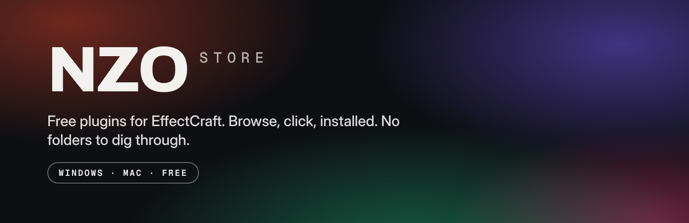</p>

<p align="center">
<b>Des plugins gratuits pour EffectCraft, à un clic.</b><br>
Parcours un beau catalogue, clique sur <i>Installer</i>, relance EffectCraft. C'est tout.
</p>

<p align="center">
<a href="../../releases/latest"><b>⬇ Télécharger pour Windows ou Mac</b></a> ·
<a href="README.md">English</a>
</p>

---

## C'est quoi NZO Store ?

NZO Store est une petite application qui donne à **EffectCraft** un magasin de plugins, un peu comme celui de Blender pour ses extensions. Au lieu de chercher des fichiers sur le web et de les copier dans des dossiers cachés, tu ouvres le store, tu choisis et tu cliques sur **Installer**.

- **Gratuit.** Tous les plugins du store sont gratuits (licence MIT).
- **Sûr.** Chaque téléchargement est vérifié avec une empreinte SHA-256 avant l'installation. Détails dans [Sécurité](#sécurité).
- **Simple.** Windows et Mac. Pas de compte, pas d'inscription.
- **Respectueux.** Il ne modifie jamais EffectCraft. Il copie seulement les fichiers des plugins dans les dossiers de plugins d'EffectCraft, là où tu les mettrais à la main.

<p align="center">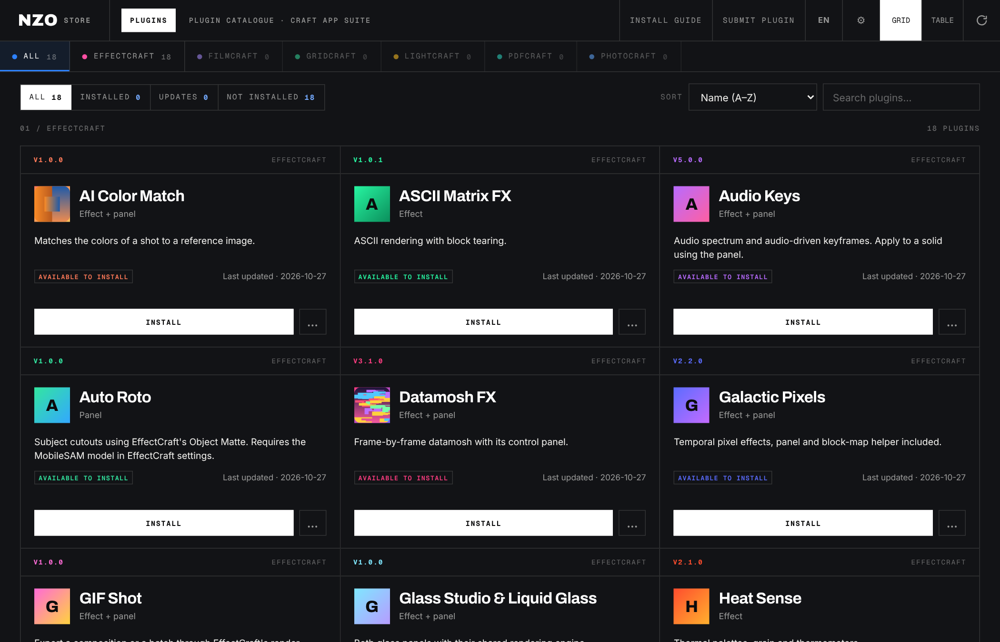</p>
<p align="center">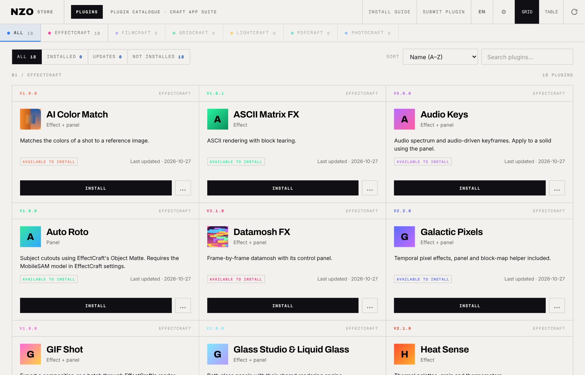</p>

<p align="center">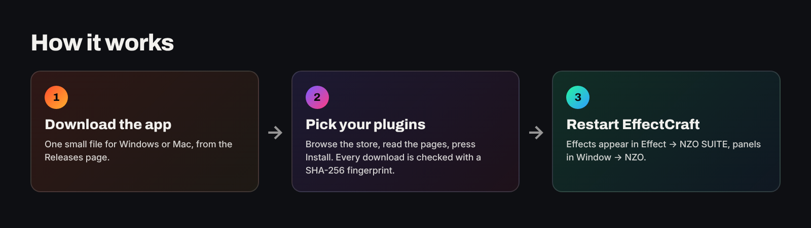</p>

## Télécharger

| Ton ordinateur | Téléchargement |
|---|---|
| Windows | **NZO-Store-Windows.zip** |
| Mac avec puce Apple (M1, M2, M3, M4…) | **NZO-Store-Mac-Apple-Silicon.zip** |
| Ancien Mac avec puce Intel | **NZO-Store-Mac-Intel.zip** |

Tout est sur la [**page Releases**](../../releases/latest) (regarde *Assets* en bas de la dernière version).

> Tu ne sais pas quel Mac tu as ? Menu Pomme ▸ **À propos de ce Mac**. Si c'est écrit *Apple M…*, prends Apple Silicon. Si c'est écrit *Intel*, prends Intel.

## Installer en 3 gestes

### Windows

1. Télécharge **NZO-Store-Windows.zip** et décompresse-le.
2. Ouvre **NZO Store.exe**.
3. Si Windows affiche *« Windows a protégé votre ordinateur »* : clique sur **Informations complémentaires**, puis **Exécuter quand même**.

> Pourquoi ce message ? L'application est récente et n'est pas signée avec un certificat Microsoft payant. Elle est sûre, et Windows ne demande qu'une fois.

### Mac

1. Télécharge le bon zip (voir le tableau), ouvre le **.dmg** et glisse **NZO Store** dans **Applications**.
2. Ouvre-la. macOS va sûrement dire qu'elle **ne peut pas être ouverte** ou qu'elle vient d'un **développeur non identifié**. Clique sur **OK**.
3. Va dans **Réglages Système ▸ Confidentialité et sécurité**, descends tout en bas et clique sur **Ouvrir quand même** à côté de *NZO Store*. Confirme avec ton mot de passe. Tu ne le fais qu'une fois.

> ⚠️ **Attention, Mac :** l'application n'est pas signée avec un compte développeur Apple payant (environ 99 $ par an), donc macOS la bloque la première fois. Ce n'est pas un virus, on n'a juste pas payé Apple. Sur un macOS plus ancien, un clic droit sur l'app puis **Ouvrir** suffit.

Ces étapes sont toujours dans l'app, sous **Installation**.

<p align="center">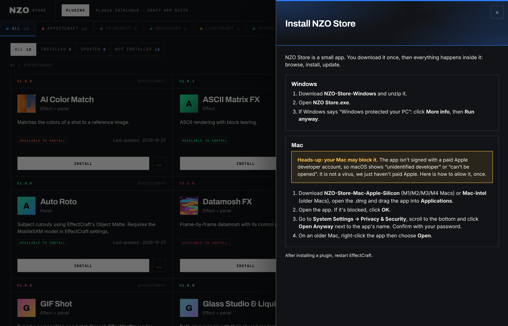</p>

## Utiliser le store

- **Parcours** les cartes, ou passe en vue **Table** pour une liste compacte.
- **Cherche** par nom ou description. Filtre par **Installés**, **Mises à jour** ou **Non installés**.
- **Ouvre un plugin** pour lire sa page : ce qu'il fait, comment l'utiliser, et des aperçus.
- Clique sur **Installer**. Un message te prévient quand c'est fini. **Relance EffectCraft** et ton plugin est là.
- Les **mises à jour** apparaissent toutes seules. **Tout mettre à jour** fait tout en un clic.
- **Les plugins déjà installés à la main** sont reconnus : si les mêmes fichiers sont déjà dans tes dossiers EffectCraft, le store les affiche comme installés. Si c'est une autre version, il te le dit et propose de la remplacer.

<p align="center">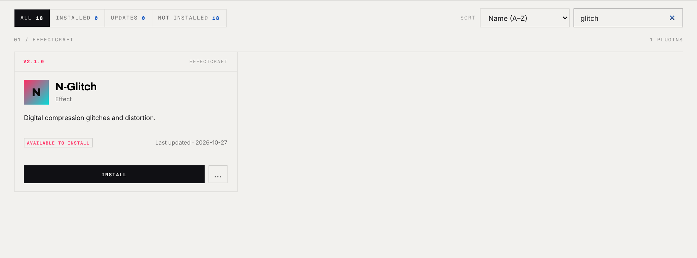</p>

### Chaque plugin a sa page et ses couleurs

<p align="center">
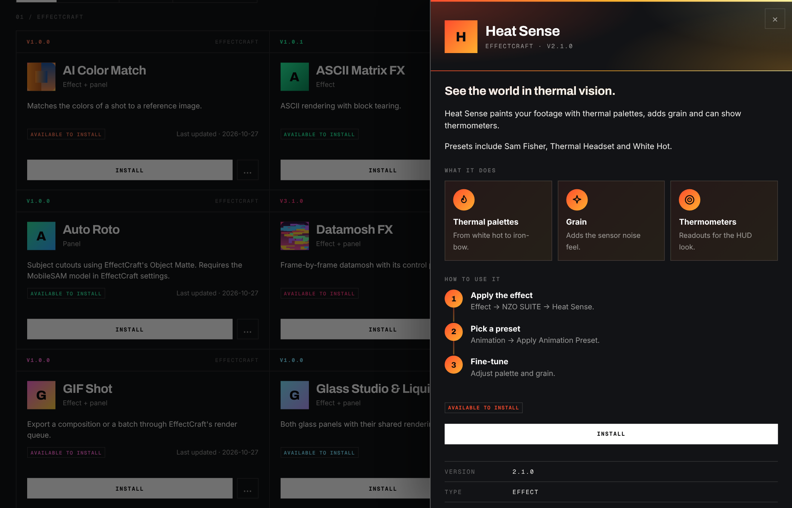
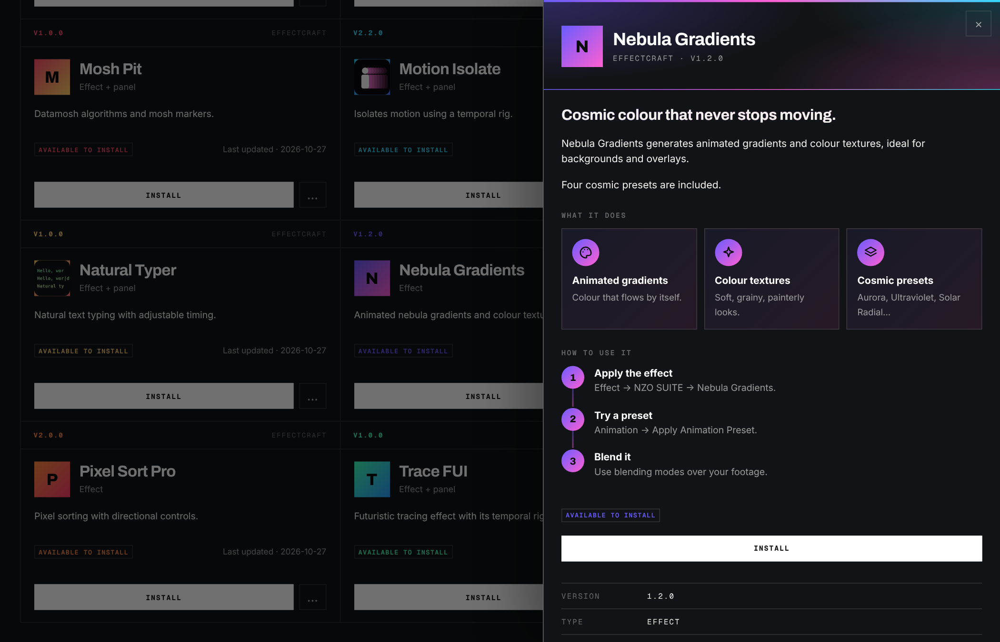
</p>
<p align="center">
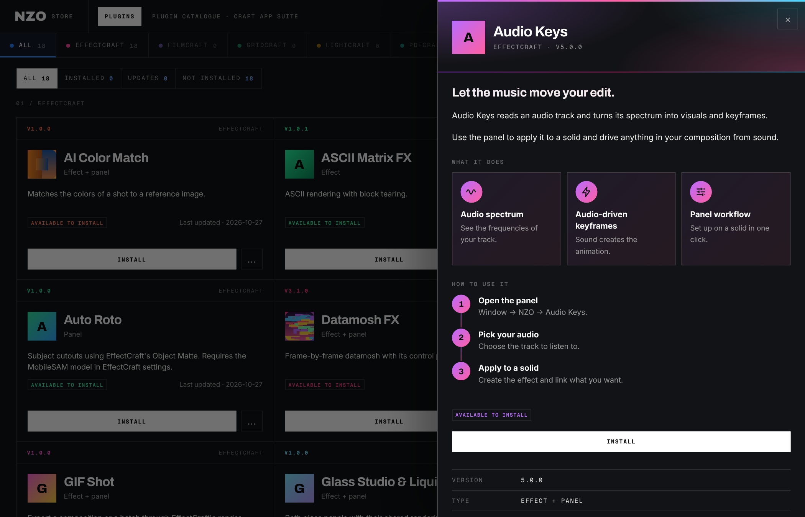
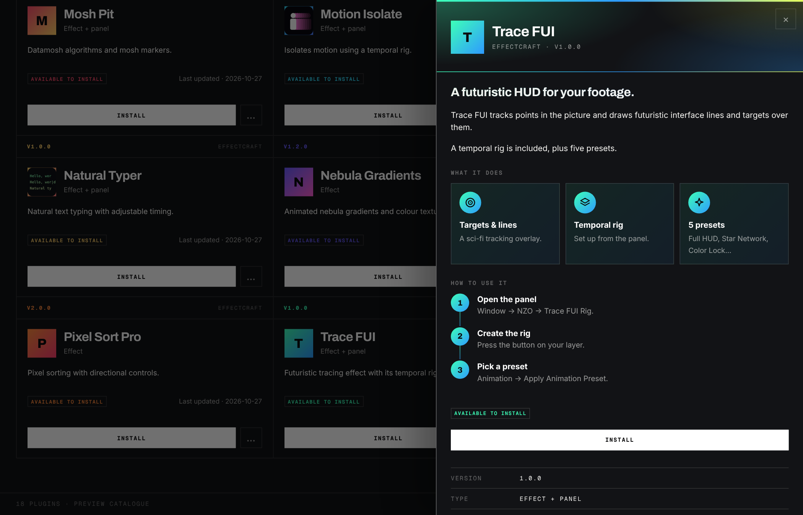
</p>

## Où vont les plugins ?

Tu n'as jamais à ouvrir ces dossiers, mais les voici :

| Système | Dossier |
|---|---|
| Windows | `%APPDATA%\EffectCraft` |
| macOS | `~/Library/Application Support/EffectCraft` |
| Linux | `~/.config/effectcraft` |

Les effets (`.wasm`) vont dans `Plug-ins`, les panneaux (`.jsx`) dans `Scripts/ScriptUI Panels`, et les presets (`.ecpreset`) dans `Documents/EffectCraft/Presets/NZO SUITE`. Dans EffectCraft, les **effets** sont dans **Effect ▸ NZO SUITE** et les **panneaux** dans **Window ▸ NZO**.

## Les plugins

<p align="center">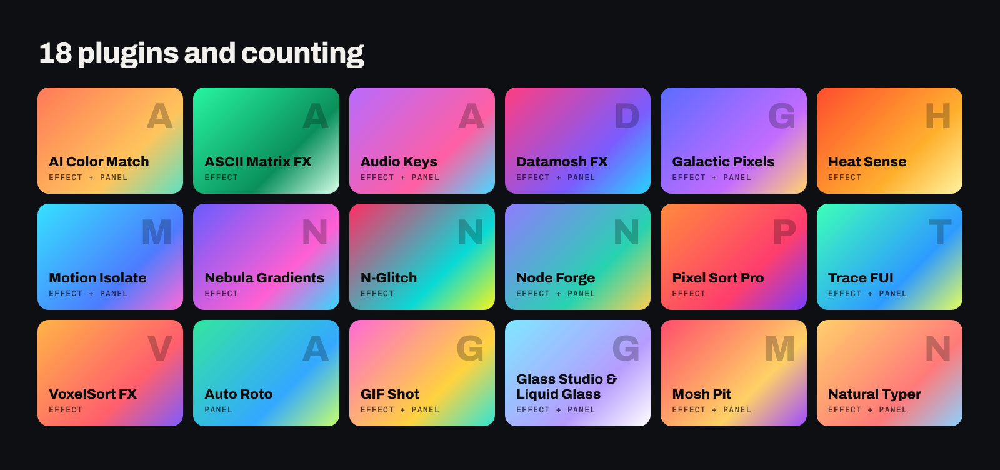</p>

| Plugin | Type | Ce qu'il fait |
|---|---|---|
| **AI Color Match** | Effet + panneau | Accorde les couleurs d'un plan sur une référence. |
| **ASCII Matrix FX** | Effet | Rendu ASCII et déchirures par blocs. |
| **Audio Keys** | Effet + panneau | Spectre audio et images clés pilotées par le son. À utiliser sur un solide via le panneau. |
| **Datamosh FX** | Effet + panneau | Datamosh image par image avec son panneau de contrôle. |
| **Galactic Pixels** | Effet + panneau | Pixels temporels avec panneau et moteur Block Map inclus. |
| **Heat Sense** | Effet | Palettes thermiques, grain et thermomètres. |
| **Motion Isolate** | Effet + panneau | Isole le mouvement avec un rig temporel. |
| **Nebula Gradients** | Effet | Dégradés animés et textures de couleur. |
| **N-Glitch** | Effet | Glitchs de compression numérique et distorsions. |
| **Node Forge** | Effet + panneau | Effets procéduraux avec éditeur de nœuds. |
| **Pixel Sort Pro** | Effet | Tri de pixels avec contrôles directionnels. |
| **Trace FUI** | Effet + panneau | Tracé futuriste avec son panneau de rig temporel. |
| **VoxelSort FX** | Effet | Tri de pixels volumétrique, presets inclus. |
| **Auto Roto** | Panneau | Détourage des sujets avec Object Matte. Nécessite le modèle MobileSAM dans les réglages d’EffectCraft. |
| **GIF Shot** | Effet + panneau | Exporte une composition ou un lot via la file de rendu d’EffectCraft. |
| **Glass Studio & Liquid Glass** | Effet + panneau | Les deux panneaux de verre avec leur moteur de rendu commun. |
| **Mosh Pit** | Effet + panneau | Algorithmes de datamosh et marqueurs mosh. |
| **Natural Typer** | Effet + panneau | Frappe de texte naturelle à rythme réglable. |

## Proposer ton plugin

Tu as fabriqué quelque chose pour EffectCraft ? Envoie-le avec le bouton **Proposer un plugin** de l'app.

1. Mets tes fichiers dans un `.zip` (20 Mo maximum) qui ne contient que des fichiers `.wasm`, `.jsx`, `.ecpreset`, `.json`, `.png`, `.md` ou `.txt`.
2. Ajoute un `icon.png` (carré, 300 Ko maximum) à la racine pour donner une image à ton plugin.
3. Facultatif mais sympa : ajoute un `store.json` pour donner à ton plugin ses couleurs et une vraie page.

```json
{
  "palette": ["#ff4d2e", "#ffb02e", "#fff3a1"],
  "tagline": "Vois le monde en vision thermique.",
  "about": ["Un ou deux courts paragraphes sur ce qu'il fait."],
  "features": [{"g": "flame", "t": "Palettes thermiques", "d": "Du white hot à l'iron-bow."}],
  "steps": [{"t": "Applique l'effet", "d": "Effect ▸ NZO SUITE ▸ Heat Sense."}]
}
```

Ajoute jusqu'à six captures dans `gallery/*.png` (600 Ko chacune). Tout est affiché en texte simple. Les champs `_fr` (`tagline_fr`, `about_fr`…) donnent une page en français.

<p align="center">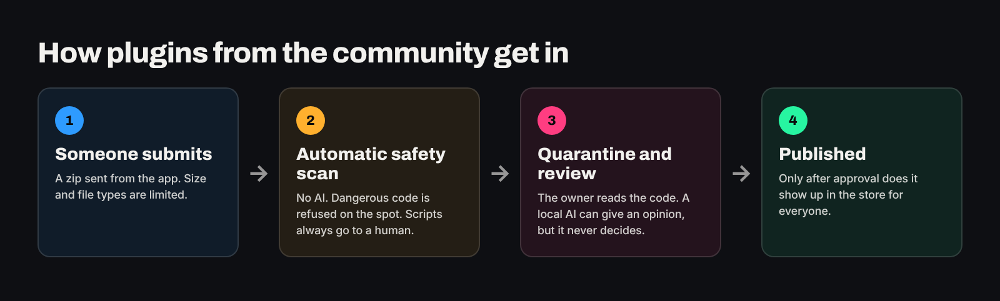</p>

Rien n'est publié automatiquement. Chaque envoi passe par les contrôles ci-dessous et une personne l'approuve.

## Sécurité

- **SHA-256 sur chaque téléchargement.** L'app compare l'empreinte de chaque fichier à celle du catalogue et refuse d'installer si elles diffèrent.
- **L'app ne fait que copier des fichiers** dans les dossiers de plugins d'EffectCraft. Elle n'exécute jamais un plugin et ne modifie jamais EffectCraft.
- **Chemins sûrs.** Les fichiers avec des chemins piégés (`../`), des liens, un mauvais type ou un faux `.wasm` sont refusés, tout comme les archives trop grosses.
- **Les plugins de la communauté passent par une quarantaine.** Un scan automatique (sans IA) refuse le code manifestement dangereux : accès réseau, commandes système, code caché. Tout script `.jsx` est toujours lu par une personne avant publication.
- **Une IA locale peut donner un avis**, mais seulement comme conseil. Elle ne peut rien approuver, et les fichiers sont traités comme du texte non fiable.
- **Limites d'envoi :** 5 par heure et par personne, 20 Mo par zip.

Un problème ? Ouvre une *issue* sur ce dépôt.

## FAQ

**C'est vraiment gratuit ?** Oui. L'app et tous les plugins du store sont gratuits.

**C'est officiel ?** Non. NZO Store est un projet communautaire non officiel, sans lien avec EffectCraft ni ArtCraft.

**Ça peut casser mon EffectCraft ?** Non. Il ajoute seulement des fichiers dans les dossiers de plugins que tu utiliserais à la main, et **Retirer** supprime exactement ce que le store a installé.

**Le store affiche « catalogue embarqué » ou hors ligne.** Les plugins embarqués s'installent quand même sans connexion. Le serveur ne sert que pour les nouvelles versions et les plugins de la communauté.

**Mon Mac dit que l'app est endommagée ou ne peut pas s'ouvrir.** Suis les étapes **Ouvrir quand même** ci-dessus. C'est parce que l'app n'est pas signée avec un compte Apple payant.

**J'ai déjà installé des plugins moi-même.** Le store les reconnaît automatiquement quand les fichiers sont identiques.

## Crédits et licence

Les plugins du store sont sous licence MIT (chaque zip contient son `LICENSE.txt`).

Le style s'inspire de l'ArtCraft Launcher. NZO Store est un projet communautaire non officiel, sans lien avec ArtCraft. Les noms et logos ArtCraft appartiennent à leurs propriétaires et ne sont pas utilisés ici. Polices : Inter, Archivo et Geist Mono (SIL Open Font License).

<p align="center"><sub>Fait avec soin par Nozomagarion.</sub></p>
