<p align="center">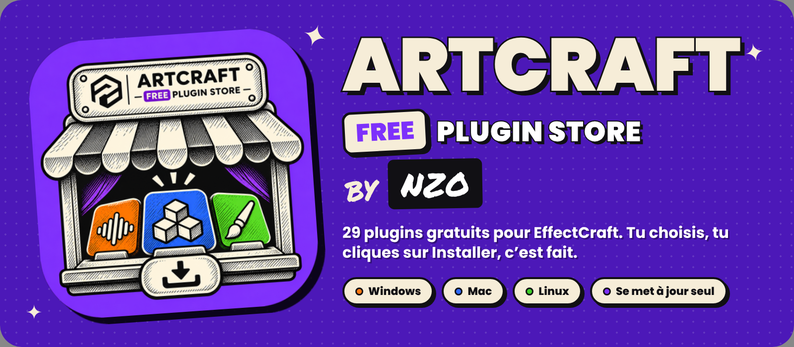</p>

<p align="center">
<a href="../../releases/latest">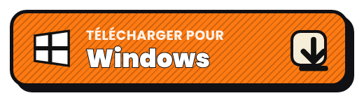</a>
<a href="../../releases/latest">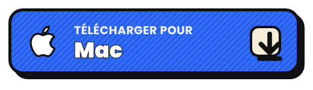</a>
<a href="../../releases/latest">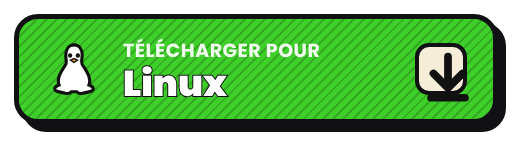</a>
</p>

<p align="center"><b>Des plugins gratuits pour EffectCraft, en un clic.</b><br>
<sub>Sans compte · aucun dossier caché · vérifié avant installation</sub><br><br>
<a href="README.md">🇬🇧 Read in English</a></p>

<br>

<p align="center">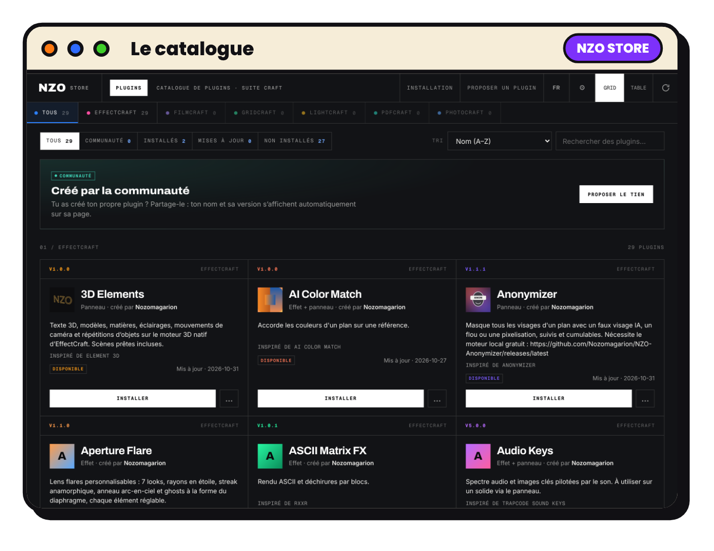</p>

<p align="center"></p>

<p align="center">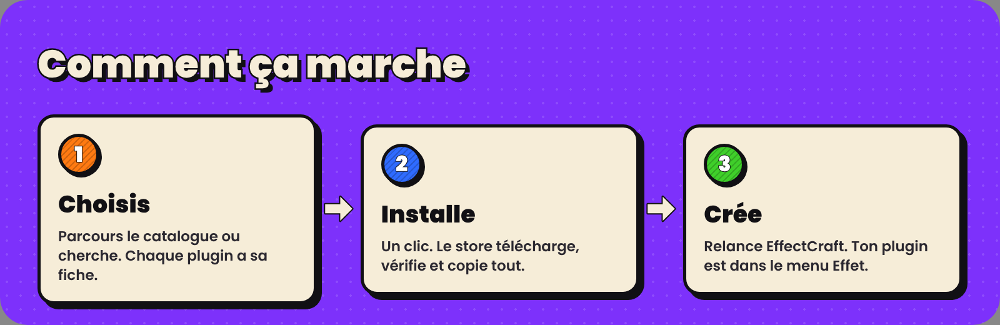</p>

## 🛍️ Un tour dans la boutique

<table>
<tr>
<td width="50%">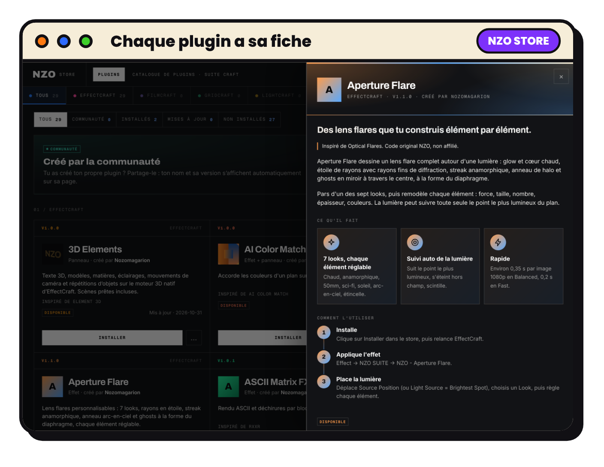<br><b>Chaque plugin a sa fiche.</b> Ce qu’il fait, comment l’utiliser, version et empreinte.</td>
<td width="50%">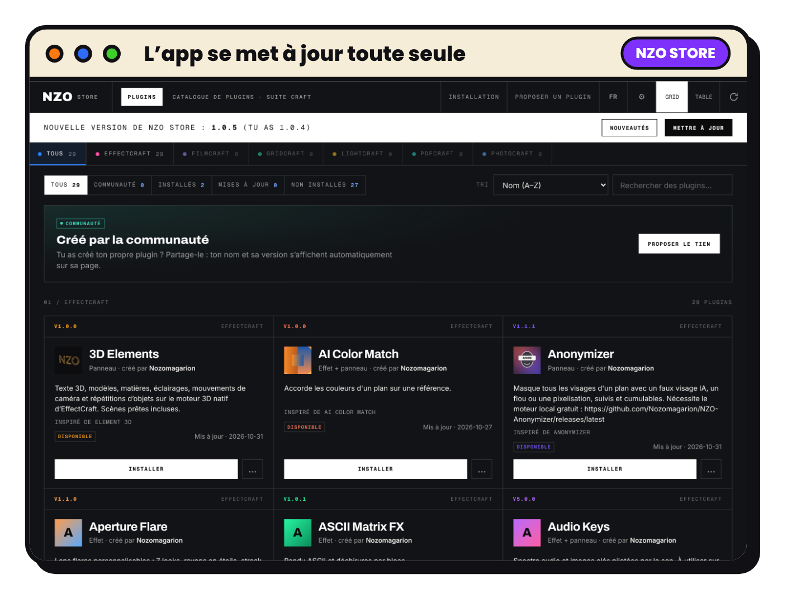<br><b>L’app se met à jour toute seule.</b> Un bandeau apparaît quand une nouvelle version sort : un clic et c’est fait.</td>
</tr>
<tr>
<td width="50%">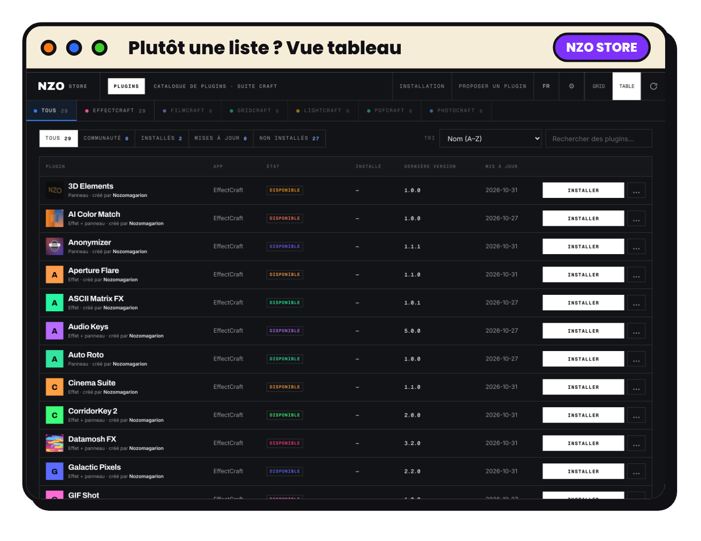<br><b>Grille ou tableau.</b> Filtre par installés, mises à jour ou non installés, et cherche par nom.</td>
<td width="50%">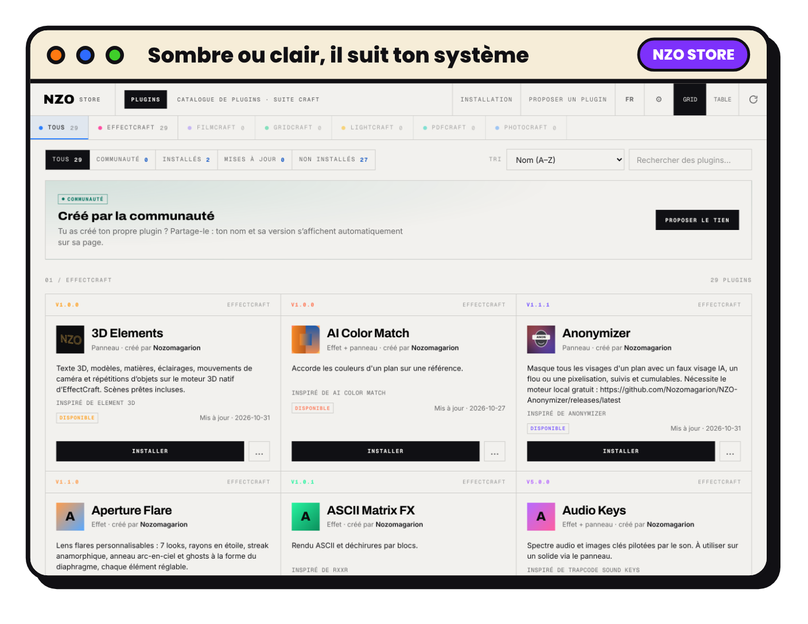<br><b>Sombre ou clair.</b> Le store suit ton système, en français ou en anglais.</td>
</tr>
</table>

<p align="center">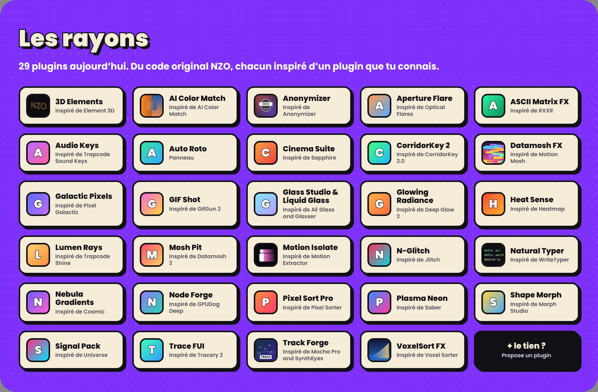</p>

<details>
<summary><b>📋 La liste complète, avec ce que fait chaque plugin</b></summary>

| Plugin | Type | Ce qu'il fait | Inspiré de |
|---|---|---|---|
| **3D Elements** | Panneau | Texte 3D, modèles, matières, éclairages, mouvements de caméra et répétitions d’objets sur le moteur 3D natif d’EffectCraft. Scènes prêtes incluses. | Element 3D |
| **AI Color Match** | Effet + panneau | Accorde les couleurs d'un plan sur une référence. | AI Color Match |
| **Anonymizer** | Panneau | Masque tous les visages d'un plan avec un faux visage IA, un flou ou une pixelisation, suivis et cumulables. Nécessite le moteur local gratuit : [NZO-Anonymizer](https://github.com/Nozomagarion/NZO-Anonymizer/releases/latest) | Anonymizer |
| **Aperture Flare** | Effet | Lens flares personnalisables : 7 looks, rayons en étoile, streak anamorphique, anneau arc-en-ciel et ghosts à la forme du diaphragme, chaque élément réglable. | Optical Flares |
| **ASCII Matrix FX** | Effet | Rendu ASCII et déchirures par blocs. | RXXR |
| **Audio Keys** | Effet + panneau | Spectre audio et images clés pilotées par le son. À utiliser sur un solide via le panneau. | Trapcode Sound Keys |
| **Auto Roto** | Panneau | Détourage des sujets avec Object Matte. Nécessite le modèle MobileSAM dans les réglages d’EffectCraft. | — |
| **Cinema Suite** | Effet | Onze effets cinéma : pellicule, déformations, flou d'objectif, kaléidoscopes, trame, flous de mouvement, netteté et clarté, dessin et peinture, relief et chrome, textures procédurales, vitrail et mosaïques. | Sapphire |
| **CorridorKey 2** | Effet + panneau | Le détourage fond vert par IA CorridorKey 2.0 (Corridor Digital) dans EffectCraft. Nécessite l'installeur gratuit du moteur, Windows et une carte NVIDIA. | CorridorKey 2.0 (Corridor Digital) |
| **Datamosh FX** | Effet + panneau | Datamosh image par image avec son panneau de contrôle. | Motion Mosh |
| **Galactic Pixels** | Effet + panneau | Pixels temporels avec panneau et moteur Block Map inclus. | Pixel Galactic |
| **GIF Shot** | Effet + panneau | Exporte une composition ou un lot via la file de rendu d’EffectCraft. | GifGun 2 |
| **Glass Studio & Liquid Glass** | Effet + panneau | Les deux panneaux de verre avec leur moteur de rendu commun. | AE Glass and Glasser |
| **Glowing Radiance** | Effet | Glow HDR réaliste en lumière linéaire : cœur chaud, longue traîne, dispersion, étirement anamorphique. | Deep Glow 2 |
| **Heat Sense** | Effet | Palettes thermiques, grain et thermomètres. | Heatmap |
| **Lumen Rays** | Effet | Rayons de lumière volumétriques depuis un point : soleil à travers les arbres, faisceaux qui jaillissent d'un titre ou d'un logo. 9 sources de lumière, 12 dégradés, scintillement en boucle, 18 modes de fusion. | Trapcode Shine |
| **Mosh Pit** | Effet + panneau | Algorithmes de datamosh et marqueurs mosh. | Datamosh 2 |
| **Motion Isolate** | Effet + panneau | Isole le mouvement avec un rig temporel. | Motion Extractor |
| **N-Glitch** | Effet | Glitchs de compression numérique et distorsions. | Jlitch |
| **Natural Typer** | Effet + panneau | Frappe de texte naturelle à rythme réglable. | WriteTyper |
| **Nebula Gradients** | Effet | Dégradés animés et textures de couleur. | Cosmic |
| **Node Forge** | Effet + panneau | 27 looks en un clic, plus un éditeur de nœuds. | GPUDog Deep |
| **Pixel Sort Pro** | Effet | Tri de pixels avec contrôles directionnels. | Pixel Sorter |
| **Plasma Neon** | Effet | Sabres d'énergie, tubes néon et lasers : ligne, cercle, contour de texte ou calque entier, 10 looks, distorsion animée et scintillement. | Saber |
| **Shape Morph** | Panneau | Morph de formes et de texte en un clic : six styles, séquences, images clés de chemin simples. | Morph Studio |
| **Signal Pack** | Effet | Quatre effets glitch et rétro : Signal Glitch, VHS Tape, CRT Screen et Glitch Transition. | Universe |
| **Trace FUI** | Effet + panneau | Tracé futuriste avec son panneau de rig temporel. | Tracery 2 |
| **Track Forge** | Panneau | Suivi de points, suivi planaire et caméra 3D avec un tracker IA de 2026, plus un export vers Blender en un clic. Nécessite le moteur local gratuit : [NZO-TrackForge](https://github.com/Nozomagarion/NZO-TrackForge/releases/latest) | Mocha Pro and SynthEyes |
| **VoxelSort FX** | Effet | Tri de pixels volumétrique, presets inclus. | Voxel Sorter |

</details>

## 📤 Tu as fait un plugin ? Mets-le en rayon

<p align="center">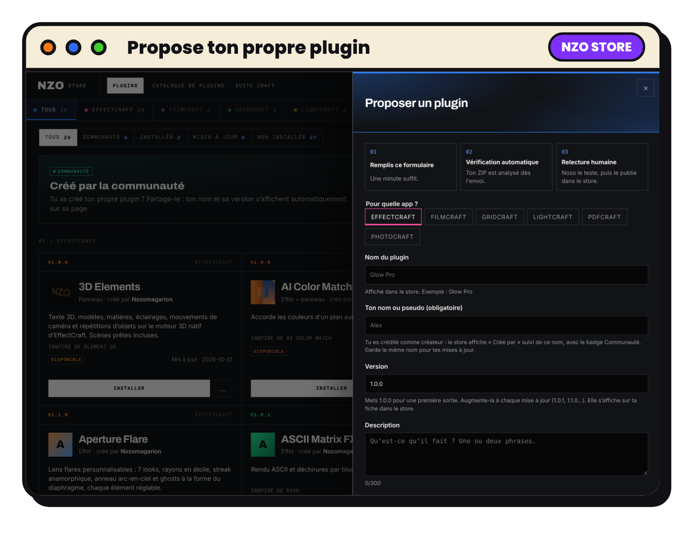</p>

Appuie sur **Proposer un plugin** dans l’app et envoie un `.zip` (20 Mo max). Ton nom apparaît comme créateur sur sa fiche, avec un badge **Communauté**. Chaque proposition est vérifiée, et une personne l’approuve avant publication.

<details>
<summary><b>Quoi mettre dans le zip</b></summary>

- Uniquement des fichiers `.wasm`, `.jsx`, `.ecpreset`, `.json`, `.png`, `.md` ou `.txt`.
- Un `icon.png` à la racine (carré, 300 Ko max) pour son image.
- En option : un `store.json` pour ses couleurs et sa fiche, et un dossier `gallery/` avec jusqu’à six captures PNG.

```json
{
  "palette": ["#ff4d2e", "#ffb02e", "#fff3a1"],
  "tagline": "See the world in thermal vision.",
  "tagline_fr": "Vois le monde en vision thermique.",
  "about": ["One or two short paragraphs about what it does."],
  "features": [{"g": "flame", "t": "Thermal palettes", "d": "From white hot to iron-bow."}],
  "steps": [{"t": "Apply the effect", "d": "Effect ▸ NZO ▸ Heat Sense."}]
}
```

Icônes des fonctions (`g`) : `wave`, `grid`, `flame`, `sparkles`, `layers`, `sliders`, `film`, `type`, `scissors`, `cube`, `bolt`, `eye`, `palette`, `download`, `target`.
</details>

## 🧰 Aide

<details>
<summary><b>🪟 Windows affiche « Windows a protégé votre ordinateur »</b></summary>

Décompresse **NZO-Store-Windows.zip**, ouvre **NZO Store.exe**, puis clique sur **Informations complémentaires** et **Exécuter quand même**. L’app n’est pas signée avec un certificat Microsoft payant. Windows ne demande qu’une fois.
</details>

<details>
<summary><b>🍎 Le Mac dit que l’app ne peut pas être ouverte</b></summary>

Prends **Apple Silicon** pour les Mac M1 à M4, **Intel** pour les plus anciens (menu Pomme ▸ À propos de ce Mac). Glisse l’app dans Applications et ouvre-la une fois. Puis va dans **Réglages Système ▸ Confidentialité et sécurité**, descends et clique sur **Ouvrir quand même**. C’est à faire une seule fois : l’app n’est pas signée avec un compte Apple payant.
</details>

<details>
<summary><b>🐧 Linux</b></summary>

Décompresse **NZO-Store-Linux.zip** et lance `./install.sh` pour l’ajouter au menu des applications. Le store s’ouvre dans ton navigateur.
</details>

<details>
<summary><b>📁 Où vont les plugins ?</b></summary>

| Système | Dossier |
|---|---|
| Windows | `%APPDATA%\EffectCraft` |
| macOS | `~/Library/Application Support/EffectCraft` |
| Linux | `~/.config/effectcraft` |

Les effets vont dans `Plug-ins`, les panneaux dans `Scripts/ScriptUI Panels`. EffectCraft n’est jamais modifié, et **Retirer** supprime exactement ce que le store a installé.
</details>

<details>
<summary><b>🔒 C’est sûr ?</b></summary>

- Chaque téléchargement est vérifié avec son empreinte SHA-256. Si elle ne correspond pas, rien n’est installé.
- L’app ne fait que copier des fichiers. Elle n’exécute jamais un plugin et ne modifie jamais EffectCraft.
- Les plugins de la communauté passent en quarantaine : une analyse automatique, puis une personne lit tout script avant publication.
- Les mises à jour de l’app viennent des Releases de ce dépôt et sont vérifiées de la même façon.
</details>

<details>
<summary><b>❓ C’est gratuit ? C’est officiel ?</b></summary>

Gratuit, oui : l’app et tous les plugins (licence MIT). Officiel, non : c’est un projet communautaire non officiel, sans lien avec ArtCraft ni EffectCraft. Les plugins sont du code original NZO inspiré de plugins connus, dont les noms appartiennent à leurs propriétaires. CorridorKey 2 est construit sur CorridorKey 2.0 de Corridor Digital, selon sa licence.
</details>

<br>

<p align="center">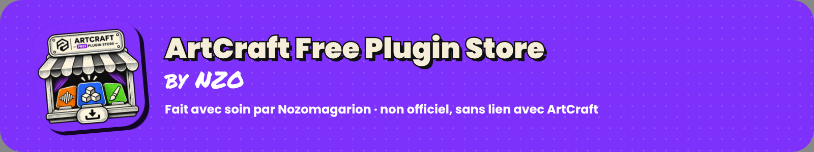</p>

