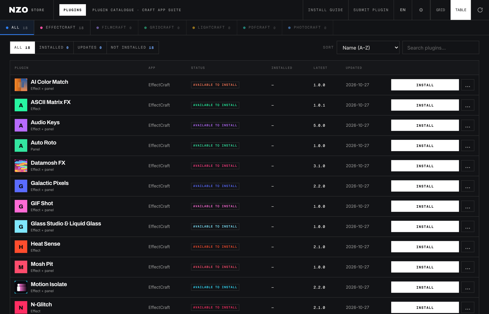

<p align="center"></p>

<p align="center">
<b>Free plugins for EffectCraft, one click away.</b><br>
Browse a beautiful catalogue, press <i>Install</i>, restart EffectCraft. That's it.
</p>

<p align="center">
<a href="../../releases/latest"><b>⬇ Download for Windows or Mac</b></a> ·
<a href="README.fr.md">Français</a>
</p>

---

## What is NZO Store?

NZO Store is a small desktop app that gives **EffectCraft** a plugin store, a bit like the one Blender has for add-ons. Instead of hunting for files on the web and copying them into hidden folders, you open the store, pick what you like and press **Install**.

- **Free.** Every plugin in the store is free (MIT licence).
- **Safe.** Every download is checked against a SHA-256 fingerprint before anything is installed. More in [Security](#security).
- **Simple.** Windows, Mac and Linux. No account, no sign-up.
- **Respectful.** It never modifies EffectCraft itself. It only copies plugin files into EffectCraft's own plugin folders, exactly where you would put them by hand.

<p align="center"></p>

<p align="center"><sub>Dark or light, the store follows your system.</sub></p>
<p align="center"></p>

<p align="center"></p>

## Download

| Your computer | Download |
|---|---|
| Windows | **NZO-Store-Windows.zip** |
| Mac with an Apple chip (M1, M2, M3, M4…) | **NZO-Store-Mac-Apple-Silicon.zip** |
| Older Mac with an Intel chip | **NZO-Store-Mac-Intel.zip** |
| Linux (64-bit, x86) | **NZO-Store-Linux.zip** |

Get them from the [**Releases page**](../../releases/latest) (look for *Assets* at the bottom of the latest release).

> Not sure which Mac you have? Click the Apple menu ▸ **About This Mac**. If it says *Apple M…* choose Apple Silicon, if it says *Intel* choose Intel.

## Install in 3 steps

### Windows

1. Download **NZO-Store-Windows.zip** and unzip it.
2. Open **NZO Store.exe**.
3. If Windows shows *"Windows protected your PC"*: click **More info**, then **Run anyway**.

> Why this message? The app is new and not signed with a paid Microsoft certificate. It is safe, and Windows only asks once.

### Mac

1. Download the right zip (see the table above), open the **.dmg** and drag **NZO Store** into **Applications**.
2. Open it. macOS will probably say it **can't be opened** or comes from an **unidentified developer**. Click **OK**.
3. Open **System Settings ▸ Privacy & Security**, scroll all the way down and click **Open Anyway** next to *NZO Store*. Confirm with your password. You only do this once.

> ⚠️ **Heads-up for Mac users:** the app isn't signed with a paid Apple Developer account (it costs about $99 a year), so macOS blocks it the first time. It's not a virus, we just haven't paid Apple. On older versions of macOS, right-click the app and choose **Open** instead.

### Linux

1. Download **NZO-Store-Linux.zip** and unzip it.
2. Run `./install.sh` from that folder to add **NZO Store** to your applications menu (or just open the **NZO Store** file directly).
3. The store opens in your web browser.

The same steps are always available inside the app, under **Install guide**.

<p align="center"></p>

## Using the store

- **Browse** the cards, or switch to **Table** view for a compact list.
- **Search** by name or description. Filter by **Installed**, **Updates** or **Not installed**.
- **Open a plugin** to read its page: what it does, how to use it, and previews.
- Press **Install**. A message tells you when it's done. **Restart EffectCraft** and your new plugin is there.
- **Updates** appear automatically. **Update all** brings everything up to date in one click.
- **Plugins you already installed by hand** are recognised: if the same files are already in your EffectCraft folders, the store shows them as installed. If the files are a different version, it says so and offers to replace them.

<p align="center"></p>

### Every plugin has its own page and colours

<p align="center">


</p>
<p align="center">


</p>

### Prefer a list?

<p align="center"></p>

## Where do the plugins go?

You never have to touch these folders, but here they are:

| System | Folder |
|---|---|
| Windows | `%APPDATA%\EffectCraft` |
| macOS | `~/Library/Application Support/EffectCraft` |
| Linux | `~/.config/effectcraft` |

Effects (`.wasm`) go in `Plug-ins`, panels (`.jsx`) go in `Scripts/ScriptUI Panels`, and presets (`.ecpreset`) go in `Documents/EffectCraft/Presets/NZO SUITE`. In EffectCraft, **effects** appear in **Effect ▸ NZO SUITE** and **panels** in **Window ▸ NZO**.

## The plugins

<p align="center"></p>

| Plugin | Type | What it does |
|---|---|---|
| **AI Color Match** | Effect + panel | Matches the colors of a shot to a reference image. |
| **ASCII Matrix FX** | Effect | ASCII rendering with block tearing. |
| **Audio Keys** | Effect + panel | Audio spectrum and audio-driven keyframes. Apply to a solid using the panel. |
| **Datamosh FX** | Effect + panel | Frame-by-frame datamosh with its control panel. |
| **Galactic Pixels** | Effect + panel | Temporal pixel effects, panel and block-map helper included. |
| **Heat Sense** | Effect | Thermal palettes, grain and thermometers. |
| **Motion Isolate** | Effect + panel | Isolates motion using a temporal rig. |
| **Nebula Gradients** | Effect | Animated nebula gradients and colour textures. |
| **N-Glitch** | Effect | Digital compression glitches and distortion. |
| **Node Forge** | Effect + panel | Procedural effects and a node editor. |
| **Pixel Sort Pro** | Effect | Pixel sorting with directional controls. |
| **Trace FUI** | Effect + panel | Futuristic tracing effect with its temporal rig. |
| **VoxelSort FX** | Effect | Volumetric pixel sorting, presets included. |
| **Auto Roto** | Panel | Subject cutouts using EffectCraft's Object Matte. Requires the MobileSAM model in EffectCraft settings. |
| **GIF Shot** | Effect + panel | Export a composition or a batch through EffectCraft's render queue. |
| **Glass Studio & Liquid Glass** | Effect + panel | Both glass panels with their shared rendering engine. |
| **Mosh Pit** | Effect + panel | Datamosh algorithms and mosh markers. |
| **Natural Typer** | Effect + panel | Natural text typing with adjustable timing. |

## Submit your own plugin

Made something for EffectCraft? Send it in with the **Submit plugin** button in the app.

1. Put your files in a `.zip` (20 MB at most) containing only `.wasm`, `.jsx`, `.ecpreset`, `.json`, `.png`, `.md` or `.txt` files.
2. Add an `icon.png` (square, up to 300 KB) at the root to give your plugin its picture.
3. Optional but nice: add a `store.json` to give your plugin its own colours and a full page.

```json
{
  "palette": ["#ff4d2e", "#ffb02e", "#fff3a1"],
  "tagline": "See the world in thermal vision.",
  "about": ["One or two short paragraphs about what it does."],
  "features": [{"g": "flame", "t": "Thermal palettes", "d": "From white hot to iron-bow."}],
  "steps": [{"t": "Apply the effect", "d": "Effect ▸ NZO SUITE ▸ Heat Sense."}]
}
```

Add up to six screenshots as `gallery/*.png` (600 KB each). Everything is shown as plain text. Add `_fr` versions of the text fields (`tagline_fr`, `about_fr`…) for a French page. Feature icons (`g`): `wave`, `grid`, `flame`, `sparkles`, `layers`, `sliders`, `film`, `type`, `scissors`, `cube`, `bolt`, `eye`, `palette`, `download`, `target`.

<p align="center"></p>

Nothing is published automatically. Every submission goes through the checks below and a person approves it.

## Security

- **SHA-256 on every download.** The app compares the fingerprint of each file with the one in the catalogue and refuses to install if they differ.
- **The app only copies files** into EffectCraft's plugin folders. It never runs a plugin, and it never changes EffectCraft.
- **Safe-by-design paths.** Files with tricky paths (`../`), links, wrong types or fake `.wasm` are refused. Archives that are too big are refused.
- **Community plugins go through quarantine.** An automatic scan (no AI) refuses obviously dangerous code, such as network access, running commands or hidden code. Anything with a `.jsx` script is always read by a person before it is published.
- **A local AI may give an opinion**, but only as advice. It can never approve anything, and files are treated as untrusted text.
- **Upload limits:** 5 per hour per person, 20 MB per zip.

Found a problem? Please open an issue on this repository.

## FAQ

**Is it really free?** Yes. The app and all plugins in the store are free.

**Is it official?** No. NZO Store is an unofficial, community project. It is not affiliated with EffectCraft or ArtCraft.

**Will it break my EffectCraft?** No. It only adds files to the same plugin folders you would use by hand, and **Remove** deletes exactly what the store installed.

**The store says "built-in catalogue" or offline.** The built-in plugins can still be installed without a connection. The server is only needed for newer versions and community plugins.

**Mac says the app is damaged or can't be opened.** Follow the **Open Anyway** steps above. It happens because the app is not signed with a paid Apple account.

**I already installed some plugins myself.** The store recognises them automatically when the files are the same.

**Which EffectCraft version do I need?** Plugins are built for EffectCraft's plugin system (WASM effects and ScriptUI panels). If a plugin page lists extra requirements, such as a model to enable in EffectCraft's settings, follow them.

## Credits and licence

Plugins in the store are released under the MIT licence (each zip contains its `LICENSE.txt`).

The look is inspired by the ArtCraft Launcher. NZO Store is an unofficial community project and is not affiliated with ArtCraft. ArtCraft names and logos belong to their owners and are not used here. Fonts: Inter, Archivo and Geist Mono (SIL Open Font License).

<p align="center"><sub>Made with care by Nozomagarion.</sub></p>
