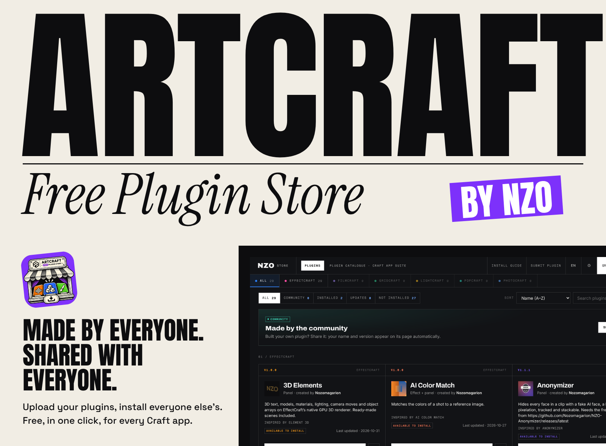
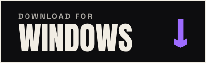
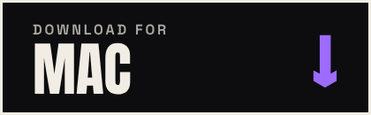
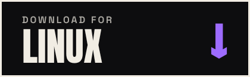
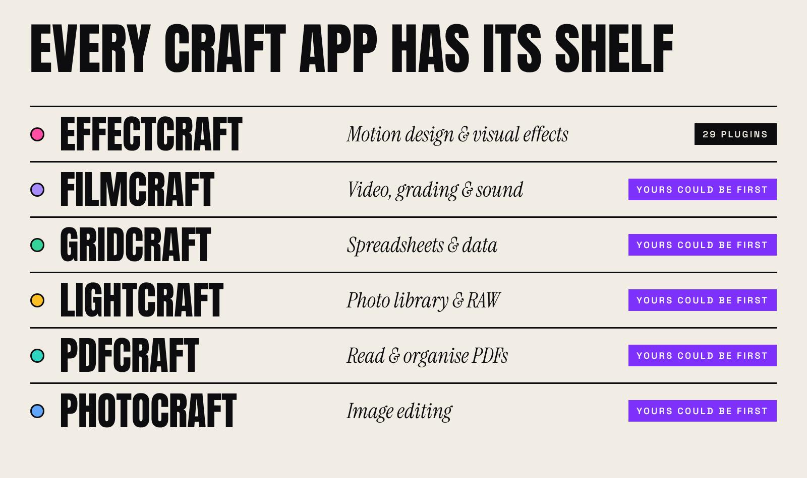
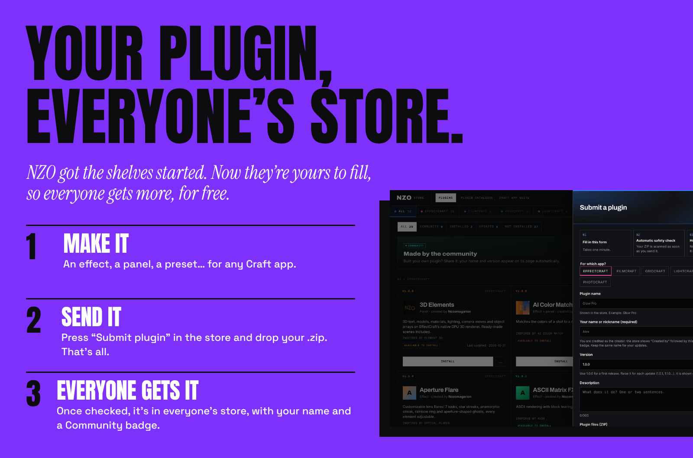
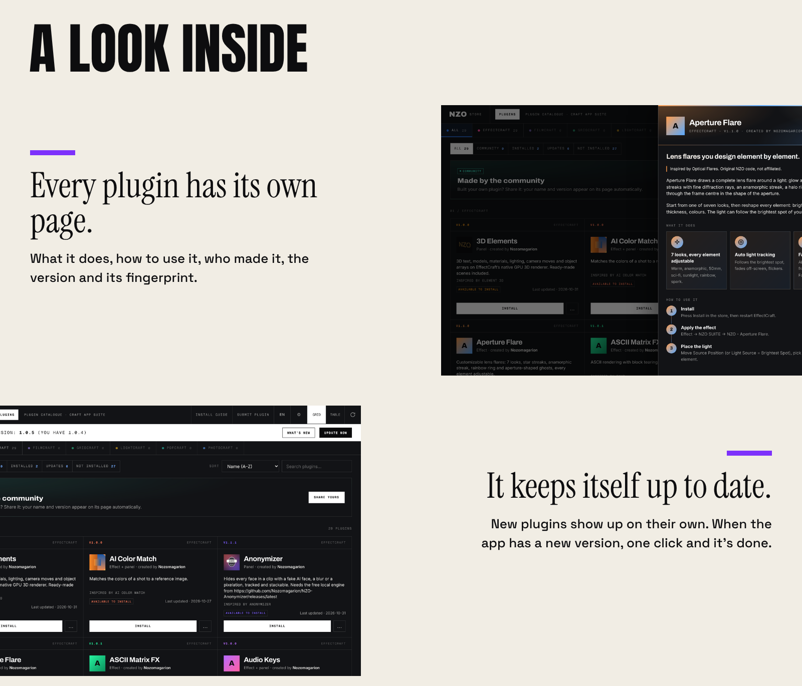
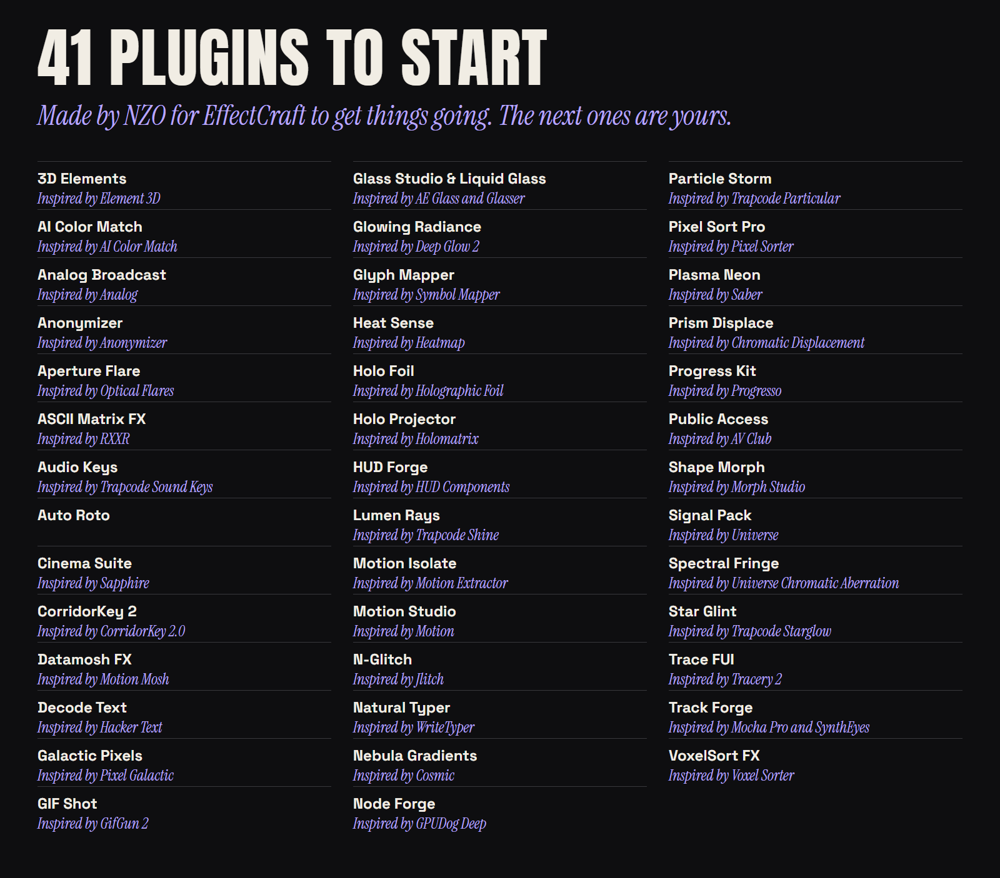
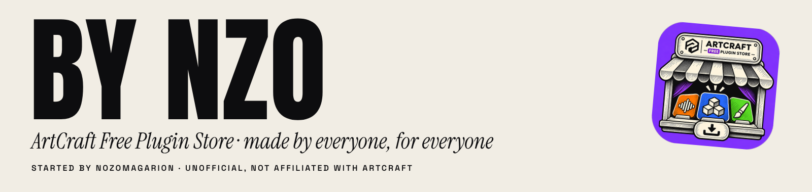

<p align="center"></p>

<p align="center">
<a href="../../releases/latest"></a>
<a href="../../releases/latest"></a>
<a href="../../releases/latest"></a>
</p>

<p align="center"><b>Made by everyone, shared with everyone.</b><br>Upload your plugins, install everyone else's. Free, in one click, for every Craft app.</p>

<p align="center"></p>

<p align="center"></p>

## 📤 Share your plugin

1. **Make it.** An effect, a panel, a preset… for any Craft app.
2. **Send it.** Open the store, press **Submit plugin**, pick the Craft app it's for and drop your `.zip`.
3. **Everyone gets it.** Once it's checked, it shows up in everyone's store, credited to you with a **Community** badge.

<details>
<summary><b>What goes in the zip</b></summary>

- Only `.wasm`, `.jsx`, `.ecpreset`, `.json`, `.png`, `.md` or `.txt` files, 20 MB max.
- An `icon.png` at the root (square, 300 KB max) gives your plugin its picture.
- Optional: a `store.json` for your own colours and a full page, and a `gallery/` folder with up to six PNG screenshots.

```json
{
  "palette": ["#ff4d2e", "#ffb02e", "#fff3a1"],
  "tagline": "See the world in thermal vision.",
  "about": ["One or two short paragraphs about what it does."],
  "features": [{"g": "flame", "t": "Thermal palettes", "d": "From white hot to iron-bow."}],
  "steps": [{"t": "Apply the effect", "d": "Effect ▸ NZO ▸ Heat Sense."}]
}
```

Feature icons (`g`): `wave`, `grid`, `flame`, `sparkles`, `layers`, `sliders`, `film`, `type`, `scissors`, `cube`, `bolt`, `eye`, `palette`, `download`, `target`.

Every submission goes through an automatic safety scan, and a person reads any script before it is published. Your name and version stay attached to your plugin, and only you can publish its updates.
</details>

<p align="center"></p>

<p align="center"></p>

<details>
<summary><b>📋 Every plugin, with what it does</b></summary>

| Plugin | Type | What it does | Inspired by |
|---|---|---|---|
| **3D Elements** | Panel | 3D text, models, materials, lighting, camera moves and object arrays on EffectCraft’s native GPU 3D renderer. Ready-made scenes included. | Element 3D |
| **AI Color Match** | Effect + panel | Matches the colors of a shot to a reference image. | AI Color Match |
| **Analog Broadcast** | Effect | Analog TV signal: chroma errors, limited bandwidth, ghost echoes, RF snow, hum bars, sync loss, screen mask, 30 looks in one click. | Analog |
| **Anonymizer** | Panel | Hides every face in a clip with a fake AI face, a blur or a pixelation, tracked and stackable. Needs the free local engine from [NZO-Anonymizer](https://github.com/Nozomagarion/NZO-Anonymizer/releases/latest) | Anonymizer |
| **Aperture Flare** | Effect | Customizable lens flares: 7 looks, star streaks, anamorphic streak, rainbow ring and aperture-shaped ghosts, every element adjustable. | Optical Flares |
| **ASCII Matrix FX** | Effect | ASCII rendering with block tearing. | RXXR |
| **Audio Keys** | Effect + panel | Audio spectrum and audio-driven keyframes. Apply to a solid using the panel. | Trapcode Sound Keys |
| **Auto Roto** | Panel | Subject cutouts using EffectCraft's Object Matte. Requires the MobileSAM model in EffectCraft settings. | — |
| **Cinema Suite** | Effect | Eleven cinema effects: film stock, warps, lens defocus, kaleidoscopes, halftone, motion blurs, sharpen and clarity, sketch and paint looks, relief and chrome, procedural textures, stained glass and mosaics. | Sapphire |
| **CorridorKey 2** | Effect + panel | Corridor Digital's CorridorKey 2.0 AI green-screen keyer, inside EffectCraft. Needs the free engine installer, Windows and an NVIDIA GPU. | CorridorKey 2.0 (Corridor Digital) |
| **Datamosh FX** | Effect + panel | Frame-by-frame datamosh with its control panel. | Motion Mosh |
| **Decode Text** | Panel | Text that decodes itself: random characters lock onto the real text, 33 styles, 28 clear settings. | Hacker Text |
| **Galactic Pixels** | Effect + panel | Temporal pixel effects, panel and block-map helper included. | Pixel Galactic |
| **GIF Shot** | Effect + panel | Export a composition or a batch through EffectCraft's render queue. | GifGun 2 |
| **Glass Studio & Liquid Glass** | Effect + panel | Both glass panels with their shared rendering engine. | AE Glass and Glasser |
| **Glowing Radiance** | Effect | Realistic HDR glow in linear light: hot core, long tail, dispersion, anamorphic stretch. | Deep Glow 2 |
| **Glyph Mapper** | Effect + panel | Rebuilds the image from symbols picked by luminance: 11 symbol sets, 42 presets, or your own 5 glyphs (any character, logo or image). | Symbol Mapper |
| **Heat Sense** | Effect | Thermal palettes, grain and thermometers. | Heatmap |
| **Holo Foil** | Effect + panel | Iridescent holographic foil: colours that shift with relief and viewing angle, 10 looks, foil patterns, sheen and glitter. A panel links it to the layer's 3D rotation. | Holographic Foil |
| **Holo Projector** | Effect | Sci-fi hologram: see-through darks, rolling scanlines, interference, flicker, glitches, glowing rim, 30 looks in one click. | Holomatrix |
| **HUD Forge** | Effect | Procedural animated HUD: 42 elements (rings, radar, reticles, gauges, readouts), 46 presets, 16 colour looks. | HUD Components |
| **Lumen Rays** | Effect | Volumetric light rays from a point: sun through trees, beams bursting from a title or logo. 9 light sources, 12 gradients, looping shimmer, 18 blend modes. | Trapcode Shine |
| **Motion Isolate** | Effect + panel | Isolates motion using a temporal rig. | Motion Extractor |
| **Motion Studio** | Panel | The animation and layout toolbox in one-click buttons: anchors, align, easing, auto animations (overshoot, bounce, wiggle, orbit), text to letters, ready shapes, colours, comp formats. Inspired by Motion. Original NZO code, not affiliated. | Motion |
| **N-Glitch** | Effect | Digital compression glitches and distortion. | Jlitch |
| **Natural Typer** | Effect + panel | Natural text typing with adjustable timing. | WriteTyper |
| **Nebula Gradients** | Effect | Animated nebula gradients and colour textures. | Cosmic |
| **Node Forge** | Effect + panel | 27 looks in one click each, plus a node editor. | GPUDog Deep |
| **Particle Storm** | Effect | A real 3D particle system in one effect: sparks, snow, fireflies, galaxies, confetti, smoke and more, 30 looks in one click. | Trapcode Particular |
| **Pixel Sort Pro** | Effect | Pixel sorting with directional controls. | Pixel Sorter |
| **Plasma Neon** | Effect | Energy beams, neon tubes and lasers: line, circle, text outline or whole layer, 10 looks, animated distortion and flicker. | Saber |
| **Prism Displace** | Effect | Chromatic displacement: a luminance, noise, ripple or radial map pushes the image while each colour moves differently, 30 looks in one click. | Chromatic Displacement |
| **Progress Kit** | Effect | Progress bars and indicators: bar, ring, gauge, pie, dots, battery, thermometer and more, auto animation, 44 presets. | Progresso |
| **Public Access** | Effect | Cheap 80s-90s local TV title look: low-res picture, retro palettes, pixel blocks, extruded shadows, snow, 30 looks in one click. | AV Club |
| **Shape Morph** | Panel | One-click shape and text morphing: six feels, sequences, plain path keyframes. | Morph Studio |
| **Signal Pack** | Effect | Four glitch and retro effects: Signal Glitch, VHS Tape, CRT Screen and Glitch Transition. | Universe |
| **Spectral Fringe** | Effect | Lens chromatic aberration: radial or directional colour fringes, clean RGB or soft spectral, 30 looks in one click. | Universe Chromatic Aberration |
| **Star Glint** | Effect | Star-shaped glints on the highlights: 4, 6 or 8 coloured rays, per-ray length, shimmer, 30 looks in one click. | Trapcode Starglow |
| **Trace FUI** | Effect + panel | Futuristic tracing effect with its temporal rig. | Tracery 2 |
| **Track Forge** | Panel | Point, planar and 3D camera tracking with a 2026 AI tracker, plus a one-click export to Blender. Needs the free local engine from [NZO-TrackForge](https://github.com/Nozomagarion/NZO-TrackForge/releases/latest) | Mocha Pro and SynthEyes |
| **VoxelSort FX** | Effect | Volumetric pixel sorting, presets included. | Voxel Sorter |

</details>

## Good to know

<details>
<summary><b>🪟 Windows says "Windows protected your PC"</b></summary>

Unzip **NZO-Store-Windows.zip**, open **NZO Store.exe**, then click **More info** and **Run anyway**. The app is not signed with a paid Microsoft certificate. Windows only asks once.
</details>

<details>
<summary><b>🍎 Mac says the app can't be opened</b></summary>

Take **Apple Silicon** for M1 to M4 Macs, **Intel** for older ones (Apple menu ▸ About This Mac). Drag the app into Applications and open it once. Then go to **System Settings ▸ Privacy & Security**, scroll down and click **Open Anyway**. You only do this once: the app is not signed with a paid Apple account.
</details>

<details>
<summary><b>🐧 Linux</b></summary>

Unzip **NZO-Store-Linux.zip** and run `./install.sh` to add it to your apps menu. The store opens in your browser.
</details>

<details>
<summary><b>🧩 Which Craft apps?</b></summary>

The store has a shelf for each Craft app: **EffectCraft, FilmCraft, GridCraft, LightCraft, PdfCraft and PhotoCraft**. The first plugins are all for EffectCraft. As soon as someone publishes a plugin for another app, it shows up on that app's shelf for everyone, with nothing to reinstall.

The store never modifies the apps themselves. It only copies plugin files into each app's own plugin folders, and **Remove** deletes exactly what it installed.
</details>

<details>
<summary><b>🔒 Is it safe?</b></summary>

- Every download is checked against its SHA-256 fingerprint. If it doesn't match, nothing is installed.
- The app only copies files. It never runs a plugin and never changes the Craft apps.
- Community plugins go through quarantine: an automatic scan, then a person reads any script before it is published.
- App updates come from this repository's Releases and are checked the same way.
</details>

<details>
<summary><b>❓ Is it free? Is it official?</b></summary>

Free, yes: the app and every plugin. Official, no: it is an unofficial community project, not affiliated with ArtCraft. The NZO plugins are original code inspired by well-known plugins, whose names belong to their owners. CorridorKey 2 is built on CorridorKey 2.0 by Corridor Digital, under its licence.
</details>

<br>

<p align="center"></p>

