<p align="center">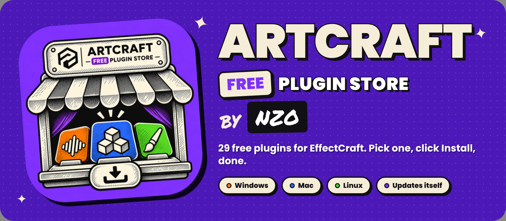</p>

<p align="center">
<a href="../../releases/latest">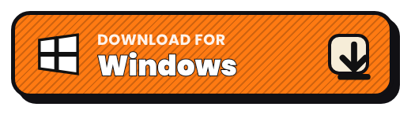</a>
<a href="../../releases/latest">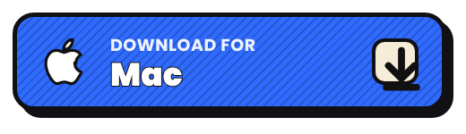</a>
<a href="../../releases/latest">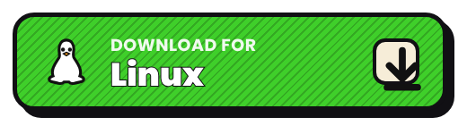</a>
</p>

<p align="center"><b>Free plugins for EffectCraft, one click away.</b><br>
<sub>No account · no hidden folders · checked before install</sub><br><br>
<a href="README.fr.md">🇫🇷 Lire en français</a></p>

<br>

<p align="center">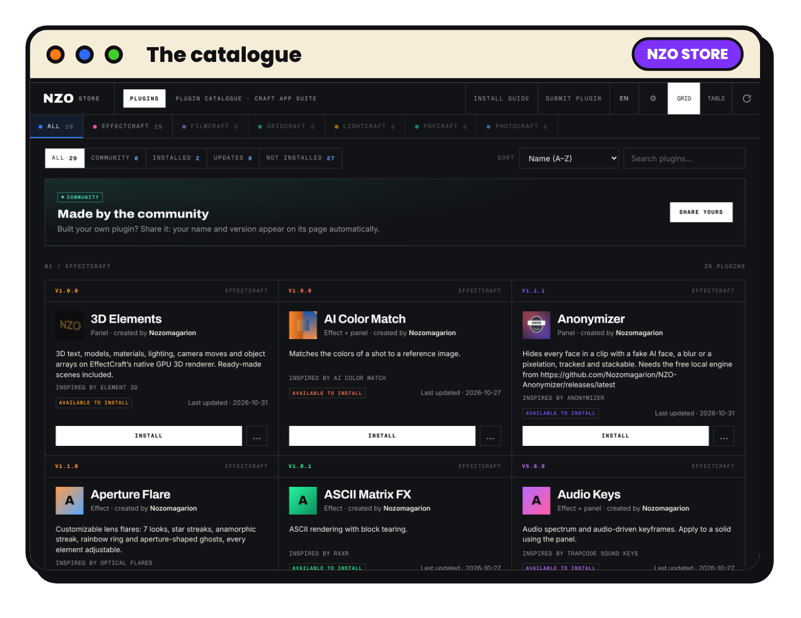</p>

<p align="center">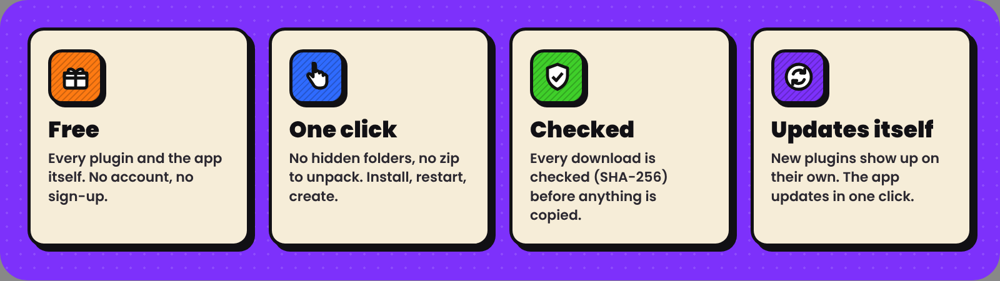</p>

<p align="center">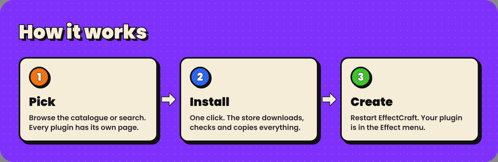</p>

## 🛍️ Take a look inside

<table>
<tr>
<td width="50%">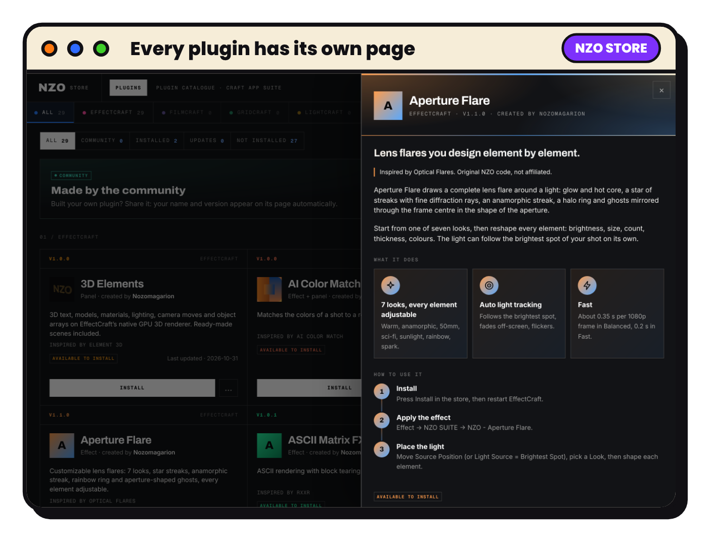<br><b>Every plugin has its own page.</b> What it does, how to use it, version and fingerprint.</td>
<td width="50%">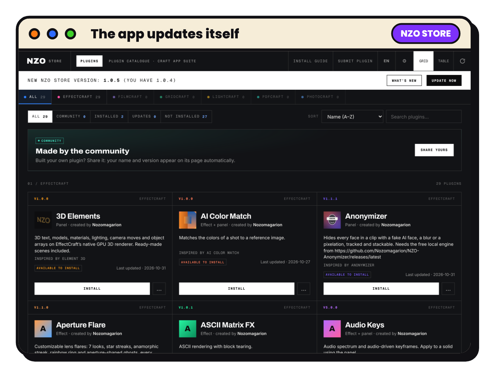<br><b>The app updates itself.</b> A banner appears when a new version is out: one click and it’s done.</td>
</tr>
<tr>
<td width="50%">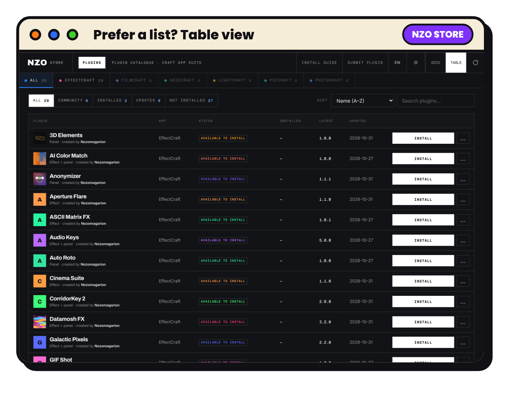<br><b>Grid or table.</b> Filter by installed, updates or not installed, and search by name.</td>
<td width="50%">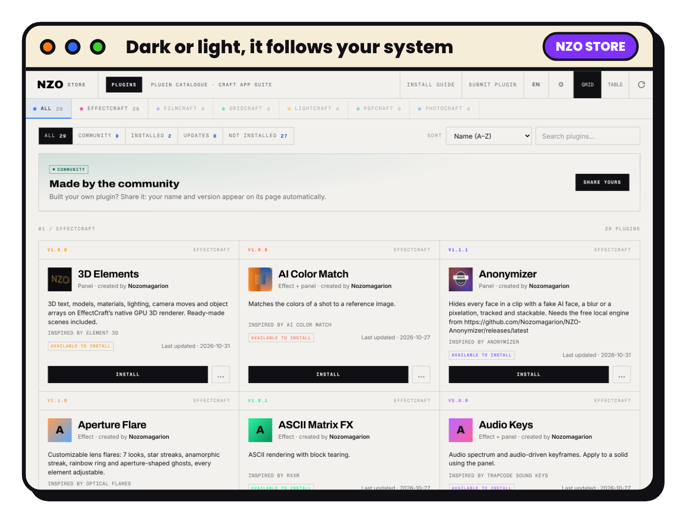<br><b>Dark or light.</b> The store follows your system, in English or French.</td>
</tr>
</table>

<p align="center">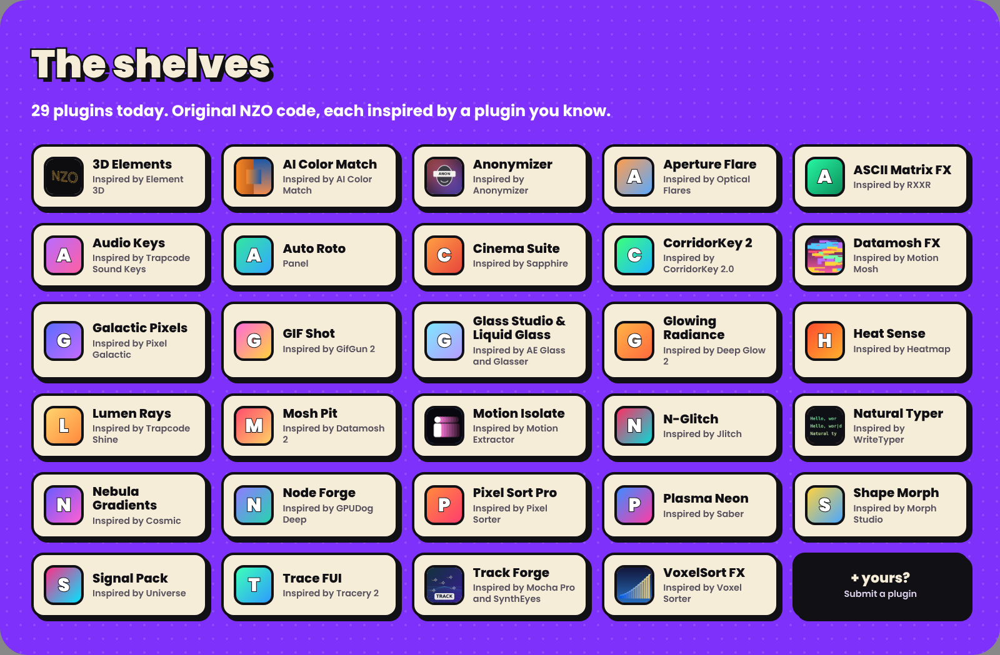</p>

<details>
<summary><b>📋 The full list, with what each plugin does</b></summary>

| Plugin | Type | What it does | Inspired by |
|---|---|---|---|
| **3D Elements** | Panel | 3D text, models, materials, lighting, camera moves and object arrays on EffectCraft’s native GPU 3D renderer. Ready-made scenes included. | Element 3D |
| **AI Color Match** | Effect + panel | Matches the colors of a shot to a reference image. | AI Color Match |
| **Anonymizer** | Panel | Hides every face in a clip with a fake AI face, a blur or a pixelation, tracked and stackable. Needs the free local engine from [NZO-Anonymizer](https://github.com/Nozomagarion/NZO-Anonymizer/releases/latest) | Anonymizer |
| **Aperture Flare** | Effect | Customizable lens flares: 7 looks, star streaks, anamorphic streak, rainbow ring and aperture-shaped ghosts, every element adjustable. | Optical Flares |
| **ASCII Matrix FX** | Effect | ASCII rendering with block tearing. | RXXR |
| **Audio Keys** | Effect + panel | Audio spectrum and audio-driven keyframes. Apply to a solid using the panel. | Trapcode Sound Keys |
| **Auto Roto** | Panel | Subject cutouts using EffectCraft's Object Matte. Requires the MobileSAM model in EffectCraft settings. | — |
| **Cinema Suite** | Effect | Eleven cinema effects: film stock, warps, lens defocus, kaleidoscopes, halftone, motion blurs, sharpen and clarity, sketch and paint looks, relief and chrome, procedural textures, stained glass and mosaics. | Sapphire |
| **CorridorKey 2** | Effect + panel | Corridor Digital's CorridorKey 2.0 AI green-screen keyer, inside EffectCraft. Needs the free engine installer, Windows and an NVIDIA GPU. | CorridorKey 2.0 (Corridor Digital) |
| **Datamosh FX** | Effect + panel | Frame-by-frame datamosh with its control panel. | Motion Mosh |
| **Galactic Pixels** | Effect + panel | Temporal pixel effects, panel and block-map helper included. | Pixel Galactic |
| **GIF Shot** | Effect + panel | Export a composition or a batch through EffectCraft's render queue. | GifGun 2 |
| **Glass Studio & Liquid Glass** | Effect + panel | Both glass panels with their shared rendering engine. | AE Glass and Glasser |
| **Glowing Radiance** | Effect | Realistic HDR glow in linear light: hot core, long tail, dispersion, anamorphic stretch. | Deep Glow 2 |
| **Heat Sense** | Effect | Thermal palettes, grain and thermometers. | Heatmap |
| **Lumen Rays** | Effect | Volumetric light rays from a point: sun through trees, beams bursting from a title or logo. 9 light sources, 12 gradients, looping shimmer, 18 blend modes. | Trapcode Shine |
| **Mosh Pit** | Effect + panel | Datamosh algorithms and mosh markers. | Datamosh 2 |
| **Motion Isolate** | Effect + panel | Isolates motion using a temporal rig. | Motion Extractor |
| **N-Glitch** | Effect | Digital compression glitches and distortion. | Jlitch |
| **Natural Typer** | Effect + panel | Natural text typing with adjustable timing. | WriteTyper |
| **Nebula Gradients** | Effect | Animated nebula gradients and colour textures. | Cosmic |
| **Node Forge** | Effect + panel | 27 looks in one click each, plus a node editor. | GPUDog Deep |
| **Pixel Sort Pro** | Effect | Pixel sorting with directional controls. | Pixel Sorter |
| **Plasma Neon** | Effect | Energy beams, neon tubes and lasers: line, circle, text outline or whole layer, 10 looks, animated distortion and flicker. | Saber |
| **Shape Morph** | Panel | One-click shape and text morphing: six feels, sequences, plain path keyframes. | Morph Studio |
| **Signal Pack** | Effect | Four glitch and retro effects: Signal Glitch, VHS Tape, CRT Screen and Glitch Transition. | Universe |
| **Trace FUI** | Effect + panel | Futuristic tracing effect with its temporal rig. | Tracery 2 |
| **Track Forge** | Panel | Point, planar and 3D camera tracking with a 2026 AI tracker, plus a one-click export to Blender. Needs the free local engine from [NZO-TrackForge](https://github.com/Nozomagarion/NZO-TrackForge/releases/latest) | Mocha Pro and SynthEyes |
| **VoxelSort FX** | Effect | Volumetric pixel sorting, presets included. | Voxel Sorter |

</details>

## 📤 Made a plugin? Put it on the shelves

<p align="center">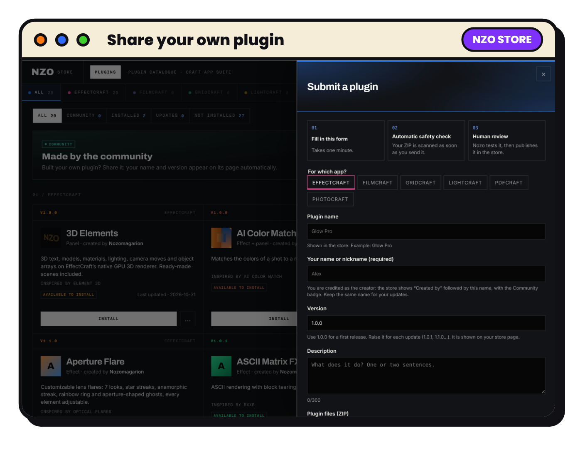</p>

Press **Submit plugin** in the app and send a `.zip` (20 MB max). Your name appears as the creator on its page, with a **Community** badge. Every submission is checked, and a person approves it before it goes live.

<details>
<summary><b>What to put in the zip</b></summary>

- Only `.wasm`, `.jsx`, `.ecpreset`, `.json`, `.png`, `.md` or `.txt` files.
- An `icon.png` at the root (square, 300 KB max) for its picture.
- Optional: a `store.json` for its own colours and page, and a `gallery/` folder with up to six PNG screenshots.

```json
{
  "palette": ["#ff4d2e", "#ffb02e", "#fff3a1"],
  "tagline": "See the world in thermal vision.",
  "tagline_fr": "Vois le monde en vision thermique.",
  "about": ["One or two short paragraphs about what it does."],
  "features": [{"g": "flame", "t": "Thermal palettes", "d": "From white hot to iron-bow."}],
  "steps": [{"t": "Apply the effect", "d": "Effect ▸ NZO ▸ Heat Sense."}]
}
```

Feature icons (`g`) : `wave`, `grid`, `flame`, `sparkles`, `layers`, `sliders`, `film`, `type`, `scissors`, `cube`, `bolt`, `eye`, `palette`, `download`, `target`.
</details>

## 🧰 Help

<details>
<summary><b>🪟 Windows says "Windows protected your PC"</b></summary>

Unzip **NZO-Store-Windows.zip**, open **NZO Store.exe**, then click **More info** and **Run anyway**. The app is not signed with a paid Microsoft certificate. Windows only asks once.
</details>

<details>
<summary><b>🍎 Mac says the app can’t be opened</b></summary>

Take **Apple Silicon** for M1 to M4 Macs, **Intel** for older ones (Apple menu ▸ About This Mac). Drag the app into Applications and open it once. Then go to **System Settings ▸ Privacy & Security**, scroll down and click **Open Anyway**. You only do this once: the app is not signed with a paid Apple account.
</details>

<details>
<summary><b>🐧 Linux</b></summary>

Unzip **NZO-Store-Linux.zip** and run `./install.sh` to add it to your apps menu. The store opens in your browser.
</details>

<details>
<summary><b>📁 Where do the plugins go?</b></summary>

| System | Folder |
|---|---|
| Windows | `%APPDATA%\EffectCraft` |
| macOS | `~/Library/Application Support/EffectCraft` |
| Linux | `~/.config/effectcraft` |

Effects go in `Plug-ins`, panels in `Scripts/ScriptUI Panels`. EffectCraft itself is never modified, and **Remove** deletes exactly what the store installed.
</details>

<details>
<summary><b>🔒 Is it safe?</b></summary>

- Every download is checked against its SHA-256 fingerprint. If it doesn’t match, nothing is installed.
- The app only copies files. It never runs a plugin and never changes EffectCraft.
- Community plugins go through quarantine: an automatic scan, then a person reads any script before it is published.
- App updates come from this repository’s Releases and are checked the same way.
</details>

<details>
<summary><b>❓ Is it free? Is it official?</b></summary>

Free, yes: the app and every plugin (MIT licence). Official, no: it is an unofficial community project, not affiliated with ArtCraft or EffectCraft. The plugins are original NZO code inspired by well-known plugins, whose names belong to their owners. CorridorKey 2 is built on CorridorKey 2.0 by Corridor Digital, under its licence.
</details>

<br>

<p align="center">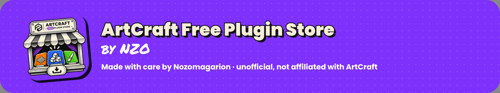</p>

